# LAPORAN PRAKTIKUM BAB 6
## CENTRALIZED LOGGING DENGAN FLUENT BIT DAN POSTGRESQL

**Disusun untuk Memenuhi Tugas Praktikum Mata Kuliah DevOps**

**Topik Praktikum:** Implementasi Centralized Logging menggunakan Fluent Bit dan PostgreSQL pada Sistem PMB DevSecOps

**Nama:** Fitria Sari Ayuningtyas

**NIM:** 3126640013

**Kelas:** STr LJ Teknik Informatika B

# 1. Tujuan Praktikum

Praktikum Bab 6 bertujuan untuk memahami penerapan centralized logging menggunakan Fluent Bit dan PostgreSQL sebagai media pengumpulan serta penyimpanan log dari beberapa layanan aplikasi. Melalui praktikum ini, mahasiswa diharapkan mampu:

1. Memahami perbedaan fungsi database transaksi dan database penyimpanan log terpusat.
2. Mengimplementasikan pengumpulan log dari beberapa layanan menggunakan Fluent Bit.
3. Memahami penggunaan structured logging untuk mencatat aktivitas aplikasi secara terstruktur.
4. Melakukan korelasi log antar layanan menggunakan `request_id`.
5. Menganalisis urutan kejadian atau timeline insiden berdasarkan data log menggunakan query SQL.
6. Menguji mekanisme retry, buffering, dan recovery ketika database log tidak tersedia.
7. Mengidentifikasi kemungkinan kehilangan log serta mengumpulkan bukti pengujian tanpa mengekspos data sensitif.

# 2. Dasar Teori Singkat

### 2.1 Centralized Logging

Centralized logging merupakan mekanisme pengumpulan log dari beberapa layanan aplikasi ke dalam satu tempat penyimpanan terpusat. Dengan mekanisme ini, aktivitas dari setiap layanan dapat dipantau dan dianalisis melalui satu sumber data. Pada praktikum ini, centralized logging digunakan untuk mengumpulkan log dari layanan `registration-api`, `auth-service`, dan `verification-worker`.

### 2.2 Fluent Bit

Fluent Bit merupakan perangkat lunak yang digunakan untuk mengumpulkan, memproses, dan meneruskan data log dari berbagai sumber. Dalam praktikum ini, Fluent Bit berperan sebagai log collector yang menerima log dari beberapa container aplikasi, kemudian meneruskannya ke PostgreSQL sebagai tempat penyimpanan log terpusat.

### 2.3 PostgreSQL sebagai Log Storage

PostgreSQL merupakan sistem manajemen basis data relasional yang digunakan untuk menyimpan dan mengelola data. Pada praktikum ini, PostgreSQL digunakan sebagai media penyimpanan log terpusat. Data log disimpan dalam tabel `logs.fluentbit` dengan struktur yang terdiri dari `tag`, `time`, dan `data` bertipe JSONB. Penggunaan JSONB memungkinkan informasi log disimpan dalam format terstruktur dan dapat dianalisis menggunakan query SQL.

### 2.4 Structured Logging

Structured logging merupakan metode pencatatan log dalam format terstruktur, seperti JSON, sehingga informasi di dalamnya dapat dibaca, dikelompokkan, dan dianalisis dengan lebih mudah. Informasi log dapat mencakup timestamp, nama layanan, tingkat keparahan (severity), jenis kejadian (event), dan `request_id`. Format ini membantu proses pencarian dan analisis aktivitas aplikasi.

### 2.5 Request ID dan Korelasi Log

Request ID merupakan identitas unik yang diberikan pada suatu permintaan untuk membantu melacak aktivitas yang terjadi selama proses berlangsung. Dengan menggunakan `request_id`, log dari beberapa layanan dapat dihubungkan sehingga urutan kejadian dalam suatu proses dapat ditelusuri. Pada praktikum ini, request ID digunakan untuk menganalisis alur pendaftaran dan mengidentifikasi penyebab kegagalan verifikasi.

### 2.6 Retry, Buffering, dan Recovery

Retry merupakan mekanisme percobaan ulang ketika proses pengiriman log mengalami kegagalan. Buffering digunakan untuk menampung sementara data log sebelum diteruskan ke tujuan penyimpanan. Sementara itu, recovery merupakan proses pemulihan setelah layanan yang mengalami gangguan kembali tersedia. Ketiga konsep ini diuji dengan menghentikan sementara PostgreSQL log database, mengamati respons Fluent Bit, kemudian mengaktifkan kembali database untuk memeriksa proses pengiriman log.

### 2.7 Analisis Log Menggunakan SQL

Structured log yang tersimpan di PostgreSQL dapat dianalisis menggunakan Structured Query Language (SQL). Query SQL dapat digunakan untuk menghitung jumlah log, mengelompokkan log berdasarkan layanan dan tingkat keparahan, serta menyusun kronologi kejadian berdasarkan request ID. Analisis ini membantu proses pemantauan dan investigasi insiden pada aplikasi.

# 3. Alat dan Lingkungan Praktikum

| **Komponen** | **Hasil Identifikasi** |
|---|---|
| Operating System | Windows |
| Lingkungan Linux | Ubuntu WSL |
| Docker | Docker Desktop |
| Docker Compose | Digunakan untuk mengelola layanan container |
| Fluent Bit | 4.2.8 |
| PostgreSQL | 16 |
| Bash | Menjalankan skrip dan perintah praktikum |
| curl | Melakukan pengujian endpoint layanan |
| Python | Python 3 |
| Git dan GitHub | Mengelola dan menyimpan repository project |
| Proyek Praktikum | PMB DevSecOps Laboratory |

### 3.1 Lingkungan Praktikum

Praktikum menggunakan proyek **PMB DevSecOps Laboratory** yang dijalankan melalui Docker Compose. Lingkungan tersebut terdiri dari enam container, yaitu:

1. `registration-api`
2. `auth-service`
3. `verification-worker`
4. `app-db`
5. `fluent-bit`
6. `log-db`

Seluruh layanan dijalankan dalam lingkungan container agar proses pengumpulan, penyimpanan, dan analisis log dapat dilakukan secara terintegrasi.

# 4. Langkah Praktikum

### 4.1 Persiapan Lingkungan Praktikum

Langkah pertama dilakukan dengan menyiapkan lingkungan praktikum PMB DevSecOps Laboratory. Proyek dijalankan melalui Ubuntu pada Windows Subsystem for Linux (WSL) dengan Docker Compose sebagai pengelola container.

Sebelum menjalankan aplikasi, dilakukan pemeriksaan struktur direktori proyek untuk memastikan file konfigurasi, skrip, dan direktori pendukung tersedia.

**Bukti struktur direktori proyek:**

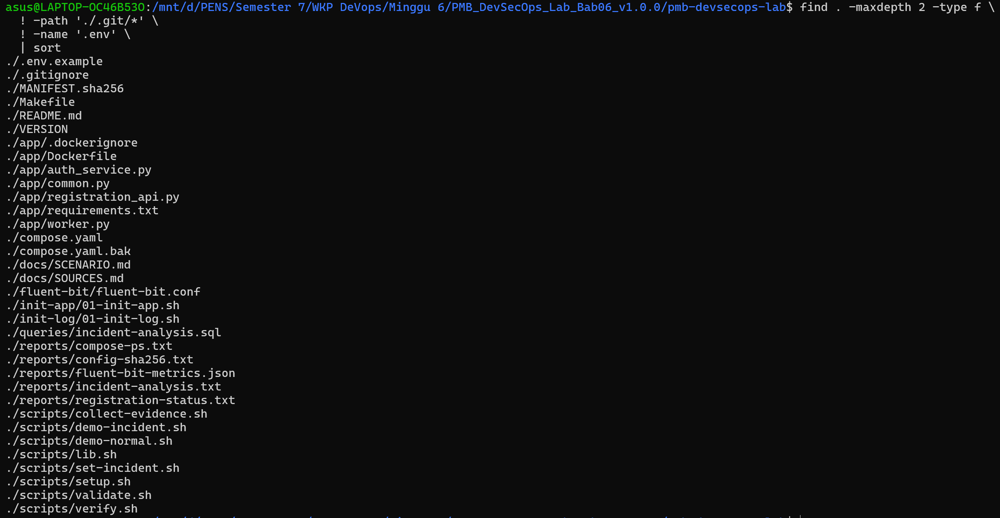

### 4.2 Menjalankan Container

Setelah persiapan selesai, seluruh layanan dijalankan menggunakan perintah berikut:

```bash
docker compose up -d --build
```

Perintah tersebut digunakan untuk membangun image apabila diperlukan dan menjalankan container di latar belakang.

Status setiap container kemudian diperiksa menggunakan perintah:

```bash
docker compose ps -a
```

Hasil pemeriksaan menunjukkan bahwa enam container, yaitu `app-db`, `auth-service`, `fluent-bit`, `log-db`, `registration-api`, dan `verification-worker`, berhasil berjalan.

**Bukti status container:**

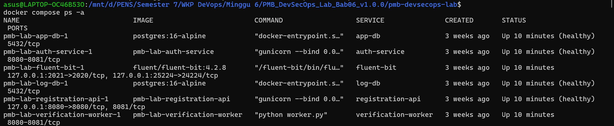

### 4.3 Pemeriksaan Health Check dan Verifikasi Sistem

Setelah seluruh container berjalan, dilakukan pemeriksaan health check untuk memastikan layanan aplikasi dan Fluent Bit dapat diakses dengan baik.

Pemeriksaan dilakukan menggunakan perintah `curl` pada endpoint berikut:

```bash
curl -i http://127.0.0.1:8080/healthz
curl -i http://127.0.0.1:2021/api/v1/health
```

Hasil pemeriksaan menunjukkan bahwa kedua endpoint memberikan respons HTTP 200 OK. Hal ini menandakan bahwa registration-api dan Fluent Bit dapat memberikan respons dengan baik.

Selanjutnya, dilakukan verifikasi menggunakan skrip:

```bash
./scripts/verify.sh
```

Hasil verifikasi menunjukkan bahwa Fluent Bit dan portal PMB siap digunakan, transaksi tersedia, log berhasil tersimpan, serta pemeriksaan secret dinyatakan bersih.

**Bukti pemeriksaan health check:**

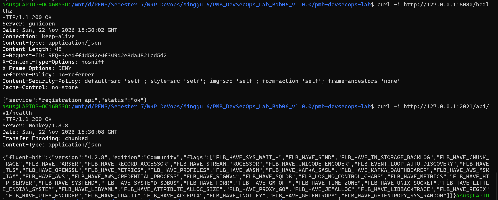

**Bukti hasil verifikasi sistem:**

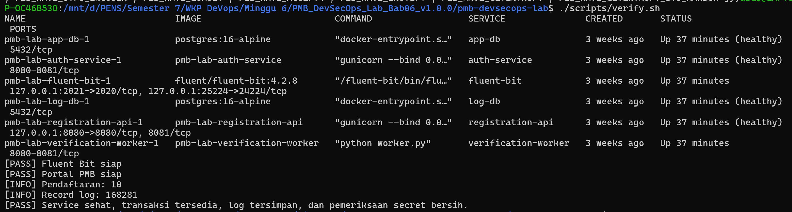

### 4.4 Pengujian Proses Pendaftaran dan Riwayat Transaksi

Pada tahap ini dilakukan pengujian proses pendaftaran mahasiswa melalui portal PMB. Pengujian bertujuan untuk memastikan bahwa pengguna dapat mengakses aplikasi, mengisi formulir pendaftaran, serta melihat hasil proses verifikasi pendaftaran.

**1. Halaman Login PMB**

Pengujian diawali dengan membuka portal PMB melalui browser. Pengguna diarahkan ke halaman login untuk masuk ke dalam sistem menggunakan akun praktikum yang telah disediakan.

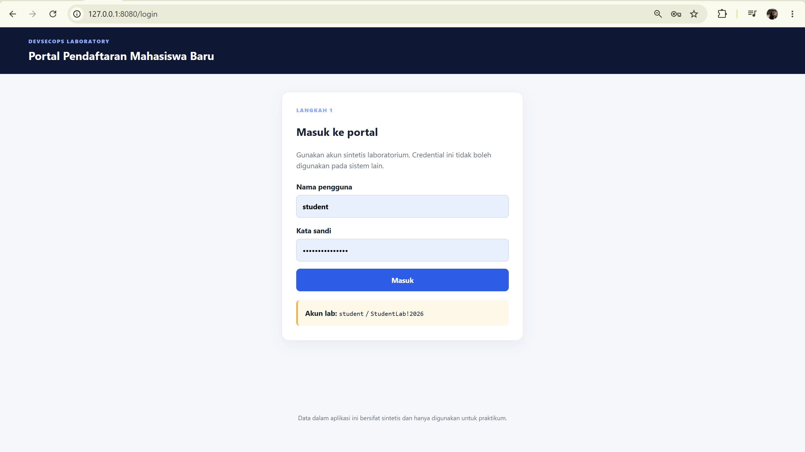

**2. Formulir Pendaftaran**

Setelah berhasil masuk, pengguna dapat mengakses formulir pendaftaran dan mengisi data menggunakan informasi sintetis yang disediakan untuk keperluan praktikum.

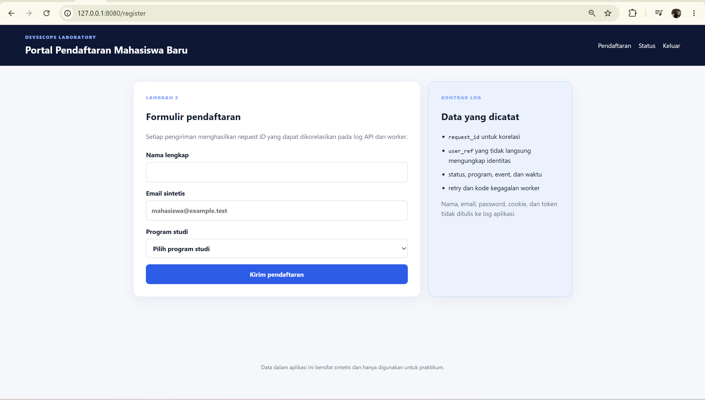

**3. Hasil Pendaftaran**

Setelah formulir dikirimkan, sistem memproses pendaftaran melalui layanan aplikasi dan proses verifikasi. Hasil pengujian menunjukkan bahwa pendaftaran berhasil diproses hingga memperoleh status `VERIFIED` dengan satu kali percobaan.

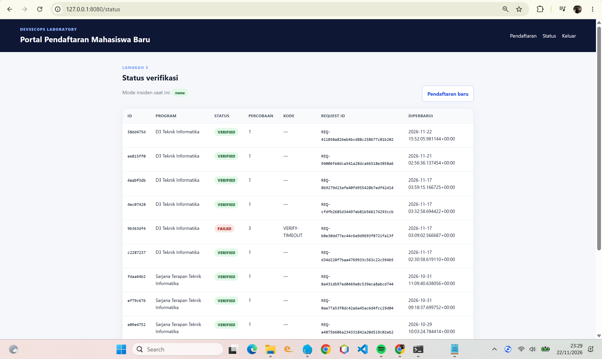

**4. Pemeriksaan Riwayat Transaksi**

Setelah proses pendaftaran dilakukan, data transaksi diperiksa melalui database `app-db` menggunakan query SQL. Pemeriksaan dilakukan untuk melihat informasi ID pendaftaran, status, jumlah percobaan, kode kegagalan, dan `request_id`.

Hasil pemeriksaan menunjukkan terdapat 10 data pendaftaran, dengan rincian 8 pendaftaran berstatus `VERIFIED` dan 2 pendaftaran berstatus `FAILED`. Dua data yang berstatus `FAILED` merupakan hasil dari simulasi gangguan timeout yang dilakukan sebelumnya.

Setelah mode insiden dikembalikan ke kondisi normal (`none`), pendaftaran baru berhasil diproses kembali dengan status `VERIFIED`.

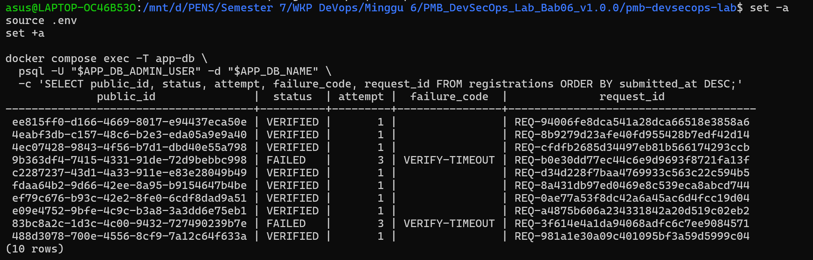

Berdasarkan hasil pengujian, proses pendaftaran dapat berjalan dengan baik pada kondisi normal. Selain itu, penggunaan `request_id` pada data transaksi membantu menghubungkan informasi pendaftaran dengan log yang dikumpulkan oleh Fluent Bit.

### 4.5 Pengumpulan dan Distribusi Log

Pada tahap ini dilakukan pemeriksaan terhadap data log yang telah dikumpulkan oleh Fluent Bit dan disimpan ke dalam PostgreSQL. Log berasal dari beberapa layanan aplikasi, yaitu `registration-api`, `auth-service`, dan `verification-worker`.

Pemeriksaan dilakukan menggunakan query SQL untuk mengelompokkan jumlah log berdasarkan tag layanan dan nama container.

Hasil pemeriksaan menunjukkan bahwa log berhasil dikumpulkan dari ketiga layanan tersebut. Jumlah log terbanyak berasal dari `registration-api`, diikuti oleh `auth-service` dan `verification-worker`.

Data log disimpan pada tabel `logs.fluentbit` dengan informasi berupa tag, waktu pencatatan, dan data log dalam format JSONB.

**Bukti distribusi log berdasarkan layanan:**

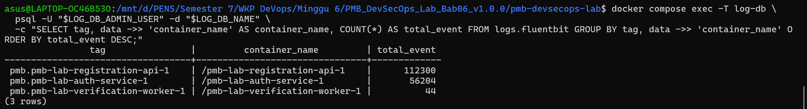

### 4.6 Analisis Insiden Menggunakan Request ID

Pada tahap ini dilakukan analisis terhadap transaksi pendaftaran yang mengalami kegagalan verifikasi dengan kode `VERIFY-TIMEOUT`. Penelusuran dilakukan menggunakan `request_id` untuk menghubungkan log dari layanan yang terlibat dalam proses pendaftaran.

Request ID yang digunakan dalam analisis adalah:

`REQ-b0e30dd77ec44c6e9d9693f8721fa13f`

Berdasarkan hasil query SQL pada tabel `logs.fluentbit`, ditemukan urutan kejadian sebagai berikut:

| Waktu | Layanan | Event | Severity |
|---|---|---|---|
| 03:08:59 | registration-api | registration_submitted | INFO |
| 03:08:59 | registration-api | http_request | INFO |
| 03:08:59 | verification-worker | verification_started | INFO |
| 03:08:59 | verification-worker | verification_retry (attempt 1) | WARN |
| 03:09:00 | verification-worker | verification_retry (attempt 2) | WARN |
| 03:09:01 | verification-worker | verification_retry (attempt 3) | WARN |
| 03:09:02 | verification-worker | dependency_timeout | ERROR |

Hasil analisis menunjukkan bahwa proses pendaftaran berhasil dimulai, kemudian diteruskan ke layanan verifikasi. Namun, layanan verifikasi mengalami kegagalan dan melakukan tiga kali percobaan ulang sebelum akhirnya menghasilkan kejadian `dependency_timeout` dengan kode `VERIFY-TIMEOUT`.

Melalui penggunaan `request_id`, rangkaian aktivitas dari beberapa layanan dapat ditelusuri sehingga penyebab kegagalan transaksi lebih mudah dianalisis.

### 4.7 Pengujian Buffering dan Recovery Fluent Bit

Pengujian dilakukan untuk mengetahui respons Fluent Bit ketika PostgreSQL sebagai log storage sementara tidak tersedia. Sebelum pengujian, jumlah log pada tabel `logs.fluentbit` tercatat sebanyak 168.785 record.

Selanjutnya, container `log-db` dihentikan sementara menggunakan perintah:

```bash
docker compose stop log-db
```

Ketika database tidak tersedia, proses pengiriman log mengalami kegagalan. Berdasarkan hasil pemeriksaan log Fluent Bit, ditemukan pesan `failed to flush chunk`, `could not translate host name`, dan `retry`. Selain itu, terdapat beberapa pesan `cannot be retried` yang menunjukkan adanya chunk yang tidak dapat dicoba ulang.

Selama kondisi tersebut, proses pendaftaran tetap dapat berjalan dan menghasilkan status `VERIFIED`. Hal ini menunjukkan bahwa layanan transaksi tetap berfungsi meskipun database penyimpanan log sedang tidak tersedia.

Setelah itu, container `log-db` diaktifkan kembali menggunakan perintah:

```bash
docker compose start log-db
```

Database kemudian kembali berjalan dengan status `healthy`. Pemeriksaan jumlah log setelah recovery menunjukkan peningkatan dari 168.785 menjadi 169.111 record, atau bertambah sebanyak 326 record.

Hasil tersebut menunjukkan bahwa log kembali masuk ke PostgreSQL setelah database aktif. Namun, peningkatan jumlah record belum membuktikan bahwa seluruh log yang dihasilkan selama gangguan berhasil dipulihkan, karena sebelumnya ditemukan chunk yang tidak dapat dicoba ulang.

**Bukti kegagalan pengiriman dan retry Fluent Bit:**

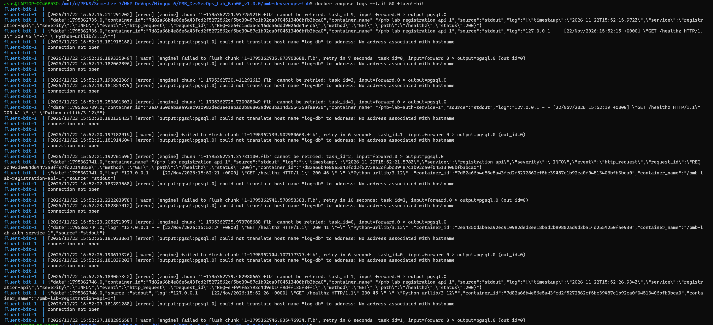

**Bukti log setelah database kembali aktif:**

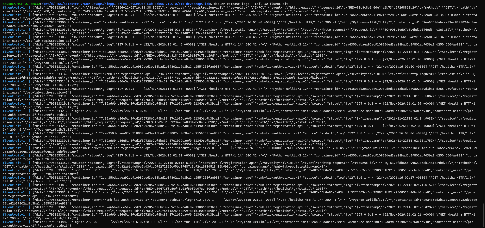

**Bukti seluruh container kembali berjalan:**

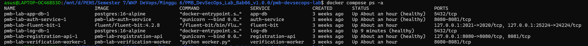

# 5. Hasil Pengujian

Berdasarkan tahapan praktikum yang telah dilakukan, diperoleh hasil pengujian sebagai berikut.

| No. | Pengujian | Hasil yang Diperoleh | Status |
|---|---|---|---|
| 1 | Menjalankan container | Enam container berhasil dijalankan | Berhasil |
| 2 | Health check layanan | Registration API dan Fluent Bit memberikan respons HTTP 200 OK | Berhasil |
| 3 | Verifikasi sistem | Portal PMB siap, transaksi tersedia, log tersimpan, dan pemeriksaan secret bersih | Berhasil |
| 4 | Proses pendaftaran normal | Pendaftaran berhasil mencapai status `VERIFIED` | Berhasil |
| 5 | Pengumpulan log | Log dari registration-api, auth-service, dan verification-worker tersimpan di PostgreSQL | Berhasil |
| 6 | Analisis request ID | Kronologi insiden berhasil ditelusuri melalui request ID | Berhasil |
| 7 | Simulasi timeout | Proses verifikasi mengalami tiga kali retry dan berakhir dengan `VERIFY-TIMEOUT` | Berhasil disimulasikan |
| 8 | Pengujian buffering dan recovery | Fluent Bit mengalami kegagalan pengiriman saat database berhenti dan kembali mengirim log setelah database aktif | Berhasil diuji, dengan indikasi kemungkinan kehilangan log |
| 9 | Pemeriksaan akhir container | Seluruh enam container kembali berjalan dan layanan database berstatus healthy | Berhasil |

### 5.1 Hasil Pengumpulan Log

Berdasarkan pemeriksaan pada tabel `logs.fluentbit`, jumlah log sebelum pengujian buffering tercatat sebanyak 168.785 record. Setelah database log diaktifkan kembali, jumlah log meningkat menjadi 169.111 record, sehingga terdapat penambahan sebanyak 326 record.

### 5.2 Hasil Analisis Insiden

Analisis menggunakan `request_id` menunjukkan bahwa transaksi dengan kode `VERIFY-TIMEOUT` mengalami tiga kali percobaan ulang pada layanan verification-worker sebelum akhirnya menghasilkan status kegagalan.

### 5.3 Hasil Pengujian Recovery

Ketika `log-db` dihentikan, Fluent Bit menunjukkan pesan kegagalan koneksi, retry, dan beberapa chunk yang tidak dapat dicoba ulang. Setelah database diaktifkan kembali, jumlah log meningkat dan record log kembali terlihat pada output Fluent Bit.

Namun, hasil pengujian belum membuktikan bahwa seluruh log selama gangguan berhasil dipulihkan. Pesan `cannot be retried` menunjukkan adanya kemungkinan kehilangan sebagian log.

# 6. Threat Statement

Berdasarkan praktikum centralized logging menggunakan Fluent Bit dan PostgreSQL, terdapat beberapa potensi ancaman dan risiko yang dapat memengaruhi proses pengumpulan serta penyimpanan log.

### 6.1 Gangguan Ketersediaan Log Database

Ketika PostgreSQL sebagai log storage tidak tersedia, Fluent Bit mengalami kegagalan dalam mengirimkan log. Kondisi ini ditunjukkan oleh pesan `failed to flush chunk` dan `could not translate host name`. Apabila gangguan berlangsung terlalu lama, proses pengumpulan log dapat terganggu.

### 6.2 Kehilangan Data Log

Berdasarkan hasil pengujian, ditemukan pesan `cannot be retried` ketika database log tidak tersedia. Kondisi tersebut menunjukkan bahwa terdapat kemungkinan sebagian chunk log tidak berhasil dikirim ulang. Hal ini dapat menyebabkan kehilangan informasi yang dibutuhkan untuk analisis dan investigasi insiden.

### 6.3 Duplikasi Data Log

Mekanisme retry memungkinkan Fluent Bit melakukan pengiriman ulang ketika terjadi kegagalan koneksi. Dalam kondisi tertentu, proses pengiriman ulang berpotensi menghasilkan data log duplikat apabila mekanisme penanganan duplikasi belum diterapkan.

### 6.4 Paparan Informasi Sensitif

Data log dapat memuat informasi yang tidak seharusnya disimpan atau ditampilkan, seperti kredensial, token, maupun data pribadi pengguna. Oleh karena itu, pencatatan log perlu memperhatikan pemilihan informasi agar tidak mengekspos data sensitif.

### 6.5 Keterbatasan Kapasitas Penyimpanan

Apabila jumlah log terus meningkat, kapasitas penyimpanan PostgreSQL dapat menjadi terbatas. Tanpa pengelolaan retensi dan pemantauan kapasitas, kondisi tersebut dapat memengaruhi kinerja penyimpanan dan proses pengumpulan log.

Berdasarkan ancaman tersebut, mekanisme retry, buffering, pemantauan layanan, serta pengelolaan data log perlu diperhatikan untuk menjaga ketersediaan dan keandalan centralized logging.

# 7. Analisis

Berdasarkan hasil praktikum, penerapan centralized logging menggunakan Fluent Bit dan PostgreSQL berhasil mengumpulkan log dari beberapa layanan aplikasi ke dalam satu tempat penyimpanan. Mekanisme ini memudahkan proses pemantauan dan analisis aktivitas aplikasi karena log dari setiap layanan dapat diperiksa melalui PostgreSQL.

### 7.1 Pemisahan Database Transaksi dan Database Log

Pada praktikum ini, database transaksi (`app-db`) dan database log (`log-db`) memiliki fungsi yang berbeda. Database transaksi digunakan untuk menyimpan data pendaftaran mahasiswa, sedangkan database log digunakan untuk menyimpan aktivitas dari layanan aplikasi.

Ketika `log-db` dihentikan sementara, proses pendaftaran tetap dapat berjalan dan menghasilkan status `VERIFIED`. Hal ini menunjukkan bahwa penyimpanan transaksi tidak bergantung langsung pada ketersediaan database log dalam skenario pengujian ini.

### 7.2 Peran Structured Logging dan Request ID

Penggunaan structured logging dalam format JSON memudahkan proses pengelompokan dan pencarian informasi log. Informasi seperti timestamp, service, severity, event, dan `request_id` dapat digunakan untuk memahami aktivitas aplikasi.

Request ID membantu menghubungkan log dari beberapa layanan sehingga kronologi suatu transaksi dapat ditelusuri. Pada pengujian timeout, request ID berhasil digunakan untuk menemukan urutan kejadian mulai dari pendaftaran dikirimkan hingga proses verifikasi mengalami kegagalan.

### 7.3 Analisis Mekanisme Retry dan Recovery

Ketika `log-db` tidak tersedia, Fluent Bit mengalami kegagalan pengiriman log dan menampilkan pesan retry. Setelah database diaktifkan kembali, jumlah log meningkat dari 168.785 menjadi 169.111 record.

Peningkatan tersebut menunjukkan bahwa data log kembali masuk ke PostgreSQL setelah layanan pulih. Namun, munculnya pesan `cannot be retried` menunjukkan adanya kemungkinan kehilangan sebagian log. Oleh karena itu, mekanisme retry dan buffering belum dapat dianggap menjamin seluruh log tersimpan tanpa kehilangan data.

### 7.4 Keterbatasan Sistem

Berdasarkan pengujian, terdapat beberapa keterbatasan yang perlu diperhatikan. Pengujian dilakukan menggunakan data sintetis dan lingkungan container lokal, sehingga belum menggambarkan seluruh kondisi penggunaan pada lingkungan produksi.

Selain itu, PostgreSQL digunakan sebagai penyimpanan log untuk skala praktikum. Apabila volume log semakin besar, diperlukan evaluasi kapasitas penyimpanan, retensi data, dan kemampuan database dalam menangani beban log yang terus meningkat.

Secara keseluruhan, praktikum menunjukkan bahwa centralized logging membantu proses pemantauan dan investigasi aktivitas aplikasi. Namun, keandalan penyimpanan log tetap dipengaruhi oleh ketersediaan database, konfigurasi buffering, dan mekanisme pemulihan ketika terjadi gangguan.

# 8. Tindak Lanjut

Berdasarkan hasil praktikum dan analisis yang telah dilakukan, terdapat beberapa tindak lanjut yang dapat diterapkan untuk meningkatkan keandalan sistem centralized logging, yaitu:

1. **Peningkatan Mekanisme Buffering:** Melakukan evaluasi konfigurasi buffering Fluent Bit agar data log tetap dapat ditampung ketika PostgreSQL sementara tidak tersedia.
2. **Pemantauan Pengiriman Log:** Menambahkan pemantauan terhadap status pengiriman log, jumlah retry, dan chunk yang gagal dikirim agar gangguan dapat diketahui lebih cepat.
3. **Pengelolaan Retensi Log:** Menerapkan kebijakan retensi untuk mengatur masa penyimpanan log agar penggunaan kapasitas database tetap terkendali.
4. **Pencegahan Duplikasi Log:** Mengevaluasi mekanisme pengiriman ulang agar proses retry tidak menyebabkan pencatatan log secara berulang.
5. **Perlindungan Informasi Sensitif:** Memastikan log tidak menyimpan kredensial, token, maupun informasi pribadi yang tidak diperlukan.
6. **Evaluasi Skalabilitas Penyimpanan:** Melakukan evaluasi terhadap penggunaan PostgreSQL apabila volume log semakin meningkat, sehingga sistem penyimpanan tetap mampu menangani kebutuhan aplikasi.

Tindak lanjut tersebut diharapkan dapat meningkatkan keandalan proses pengumpulan, penyimpanan, dan analisis log pada sistem PMB DevSecOps.

# 9. Kesimpulan

Berdasarkan praktikum Bab 6 mengenai Centralized Logging menggunakan Fluent Bit dan PostgreSQL, dapat disimpulkan bahwa penerapan centralized logging berhasil mengumpulkan log dari beberapa layanan aplikasi ke dalam satu tempat penyimpanan terpusat.

Fluent Bit berperan sebagai pengumpul dan penerus log dari layanan `registration-api`, `auth-service`, dan `verification-worker` menuju PostgreSQL. Penggunaan structured logging dan `request_id` membantu proses pencarian, pengelompokan, serta penelusuran kronologi aktivitas aplikasi menggunakan query SQL.

Pengujian simulasi timeout berhasil menunjukkan proses retry pada layanan verifikasi hingga menghasilkan kode kegagalan `VERIFY-TIMEOUT`. Selain itu, pengujian buffering dan recovery menunjukkan bahwa proses pendaftaran tetap dapat berjalan ketika database log tidak tersedia. Setelah database diaktifkan kembali, jumlah log yang tersimpan mengalami peningkatan.

Namun, ditemukannya pesan `cannot be retried` menunjukkan adanya kemungkinan kehilangan sebagian log selama gangguan. Dengan demikian, mekanisme buffering dan retry perlu dievaluasi lebih lanjut untuk meningkatkan keandalan penyimpanan log.

Secara keseluruhan, praktikum ini memberikan pemahaman mengenai penerapan centralized logging, analisis insiden menggunakan SQL, serta pentingnya pengelolaan log untuk mendukung pemantauan dan investigasi aktivitas sistem.

# 10. Penggunaan AI

Dalam pengerjaan praktikum Bab 6, Artificial Intelligence (AI) digunakan sebagai alat bantu untuk mendukung proses pembelajaran dan penyusunan laporan. AI yang digunakan adalah ChatGPT dari OpenAI.

Pemanfaatan AI meliputi:

1. Membantu memahami konsep centralized logging, Fluent Bit, PostgreSQL, structured logging, retry, dan buffering.
2. Memberikan panduan dalam menjalankan perintah terminal dan memahami hasil pengujian.
3. Membantu menganalisis pesan error serta hasil pemeriksaan log selama praktikum.
4. Membantu menyusun dan merapikan dokumentasi hasil praktikum ke dalam format Markdown.

Seluruh proses pelaksanaan praktikum, pengoperasian lingkungan Docker, pengujian layanan, serta pengumpulan bukti dilakukan secara langsung oleh mahasiswa. Hasil yang diperoleh kemudian diperiksa dan digunakan sebagai dasar penyusunan laporan.

# 11. Referensi

1. PMB DevSecOps Laboratory. *Bab 6: Centralized Logging dengan Fluent Bit dan PostgreSQL*. README dan dokumentasi proyek praktikum.

2. Fluent Bit. *Official Documentation*. https://docs.fluentbit.io/manual/

3. PostgreSQL Global Development Group. *PostgreSQL 16 Documentation*. https://www.postgresql.org/docs/16/

4. Docker. *Docker Compose Documentation*. https://docs.docker.com/compose/

5. OpenAI. *ChatGPT*. https://chatgpt.com/
