# LAPORAN PRAKTIKUM BAB 6
## CENTRALIZED LOGGING DENGAN FLUENT BIT DAN POSTGRESQL

**Mata Kuliah:** DevOps

**Topik Praktikum:** Centralized Logging dengan Fluent Bit dan PostgreSQL

**Nama:** Fitria Sari Ayuningtyas

**NIM:** 3126640013

**Kelas:** STr LJ Teknik Informatika B


---

# 1. Pendahuluan

Praktikum Bab 6 membahas penerapan centralized logging menggunakan Fluent Bit dan PostgreSQL. Praktikum ini bertujuan untuk memahami proses pengumpulan log dari beberapa container Docker, pemrosesan log menggunakan Fluent Bit, serta penyimpanan data log ke dalam database PostgreSQL dengan format JSONB.

Melalui praktikum ini, dilakukan simulasi pengiriman log dari beberapa container, penerapan filter untuk penyamaran data, serta pengujian penyimpanan dan analisis log menggunakan query SQL.

# 2. Tujuan Praktikum

1. Memahami konsep centralized logging pada lingkungan container.
2. Mengirimkan log container Docker ke Fluent Bit menggunakan logging driver Fluentd.
3. Menyimpan data log ke PostgreSQL menggunakan tipe data JSONB.
4. Melakukan pemrosesan dan penyamaran data log menggunakan filter Lua.
5. Melakukan analisis serta pengujian terhadap data log yang tersimpan.


# 3. Alat dan Lingkungan Praktikum

Praktikum Centralized Logging dilaksanakan menggunakan perangkat keras dan perangkat lunak yang mendukung proses pengumpulan, pemrosesan, penyimpanan, serta analisis log dari container Docker.

Adapun alat dan lingkungan yang digunakan dalam praktikum ini adalah sebagai berikut.

| No. | Alat atau Teknologi | Keterangan |
|---|---|---|
| 1 | Laptop | Perangkat untuk menjalankan praktikum |
| 2 | Windows | Sistem operasi utama |
| 3 | WSL (Windows Subsystem for Linux) | Lingkungan Linux untuk menjalankan perintah praktikum |
| 4 | Docker | Menjalankan aplikasi dalam container |
| 5 | Docker Compose | Mengelola beberapa layanan container |
| 6 | Fluent Bit 3.2 | Mengumpulkan dan memproses log |
| 7 | PostgreSQL 16 | Menyimpan data log |
| 8 | Alpine Linux 3.20 | Image untuk menjalankan container generator log |
| 9 | Git dan GitHub | Mengelola dan menyimpan repository project |
| 10 | Terminal Linux | Menjalankan perintah dan pengujian praktikum |

# 4. Struktur Direktori Project

Project praktikum Bab 6 disusun dalam beberapa direktori untuk memisahkan konfigurasi layanan, skrip inisialisasi database, query analisis, serta file pendukung pengujian. Struktur direktori yang digunakan adalah sebagai berikut.

```text
bab-6/
├── .env.example
├── .gitignore
├── compose.yaml
├── compose.yaml.bak
├── evidence/
│   ├── generator-logs-backup.csv
│   ├── log-export.csv
│   └── log-export.sha256
├── fluent-bit/
│   ├── fluent-bit.conf
│   ├── fluent-bit.conf.bak
│   └── redact.lua
├── init/
│   └── 01-init-logging.sh
├── queries/
│   └── analysis.sql
└── scripts/
    └── test-buffering.sh
```

Keterangan direktori dan file:

- `.env.example`: Berisi contoh variabel lingkungan untuk konfigurasi PostgreSQL dan Fluent Bit.
- `.gitignore`: Menentukan file dan direktori yang tidak disertakan dalam pelacakan Git.
- `compose.yaml`: Mengatur layanan Docker yang digunakan dalam praktikum.
- `compose.yaml.bak`: File cadangan konfigurasi Docker Compose.
- `evidence/`: Menyimpan hasil ekspor log, backup log generator, dan checksum.
- `fluent-bit/`: Menyimpan konfigurasi Fluent Bit, skrip penyamaran data, dan file cadangan konfigurasi.
- `init/`: Menyimpan skrip inisialisasi database PostgreSQL.
- `queries/`: Menyimpan query SQL untuk analisis data log.
- `scripts/`: Menyimpan skrip otomatisasi pengujian buffering.


# 5. Implementasi dan Konfigurasi

Bagian ini menjelaskan implementasi dan konfigurasi komponen yang digunakan dalam pembangunan sistem centralized logging. Konfigurasi meliputi pengaturan variabel lingkungan, pengelolaan file Git, Docker Compose, Fluent Bit, serta inisialisasi database PostgreSQL.

### 5.1 Konfigurasi Environment (`.env.example`)

File `.env.example` digunakan sebagai contoh konfigurasi variabel lingkungan yang dibutuhkan oleh layanan PostgreSQL dan Fluent Bit.

Berikut isi konfigurasi `.env.example`:

```env
POSTGRES_DB=labdb
POSTGRES_USER=labadmin
POSTGRES_PASSWORD=labadminpass123

FLUENTBIT_DB_USER=fluentbit_user
FLUENTBIT_DB_PASSWORD=fluentbitpass123
```

Variabel `POSTGRES_DB`, `POSTGRES_USER`, dan `POSTGRES_PASSWORD` digunakan untuk mengatur database PostgreSQL. Sementara itu, `FLUENTBIT_DB_USER` dan `FLUENTBIT_DB_PASSWORD` digunakan sebagai kredensial koneksi Fluent Bit ke PostgreSQL.

**Dokumentasi konfigurasi:**

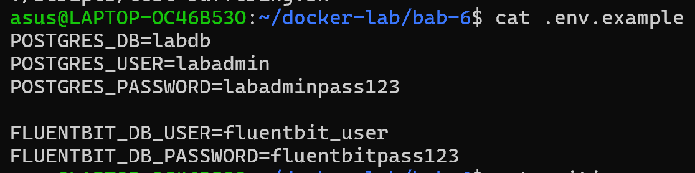

*Gambar 5.1 Tampilan Konfigurasi Variabel Environment pada File `.env.example`.*


### 5.2 Konfigurasi Git Ignore (`.gitignore`)

File `.gitignore` digunakan untuk menentukan file dan direktori yang tidak perlu disertakan dalam pelacakan Git. Pada praktikum ini, file tersebut digunakan untuk mengabaikan file environment, file log, serta direktori laporan.

Berikut isi konfigurasi `.gitignore`:

```gitignore
.env
*.log
reports/
```

Keterangan konfigurasi:

1. `.env`: Mengabaikan file yang berisi variabel lingkungan dan kredensial konfigurasi.
2. `*.log`: Mengabaikan seluruh file dengan ekstensi `.log`.
3. `reports/`: Mengabaikan direktori `reports` beserta isinya.

Dengan konfigurasi tersebut, file dan direktori yang telah ditentukan tidak akan disertakan dalam pelacakan Git.

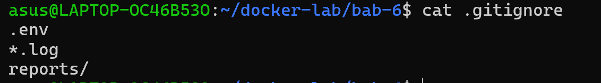
Gambar 5.2 Tampilan Konfigurasi File .gitignore.

### 5.3 Konfigurasi Docker Compose (`compose.yaml`)

File `compose.yaml` digunakan untuk mengatur dan menjalankan seluruh layanan yang dibutuhkan dalam praktikum Centralized Logging. Layanan yang digunakan terdiri dari PostgreSQL sebagai penyimpanan log, Fluent Bit sebagai pengumpul dan pengirim log, serta tiga container generator untuk menghasilkan log secara otomatis.

**a. Konfigurasi layanan PostgreSQL**

```yaml
services:
  postgres-db:
    image: postgres:16-alpine
    container_name: bab6-postgres-db
    restart: unless-stopped
    env_file:
      - .env
    ports:
      - "127.0.0.1:5433:5432"
    volumes:
      - postgres_data:/var/lib/postgresql/data
      - ./init:/docker-entrypoint-initdb.d:ro
    healthcheck:
      test: ["CMD-SHELL", "pg_isready -U \"$${POSTGRES_USER}\" -d \"$${POSTGRES_DB}\""]
      interval: 5s
      timeout: 3s
      retries: 10
```

PostgreSQL menggunakan image `postgres:16-alpine` dan berfungsi sebagai tempat penyimpanan log. Data disimpan menggunakan Docker volume agar tetap tersedia meskipun container dihentikan atau dibuat ulang. Health check digunakan untuk memastikan PostgreSQL siap menerima koneksi.

**b. Konfigurasi layanan Fluent Bit**

```yaml
  fluent-bit:
    image: cr.fluentbit.io/fluent/fluent-bit:3.2
    container_name: bab6-fluent-bit
    restart: unless-stopped
    env_file:
      - .env
    depends_on:
      postgres-db:
        condition: service_healthy
    ports:
      - "127.0.0.1:2020:2020"
      - "127.0.0.1:24224:24224"
    volumes:
      - ./fluent-bit/fluent-bit.conf:/fluent-bit/etc/fluent-bit.conf:ro
      - fluentbit_storage:/var/log/flb-storage
      - ./fluent-bit/redact.lua:/fluent-bit/etc/redact.lua:ro
    command: ["--config", "/fluent-bit/etc/fluent-bit.conf"]
```

Fluent Bit bertugas menerima log dari container lain, melakukan pemrosesan sesuai konfigurasi, kemudian mengirimkannya ke PostgreSQL. Layanan ini dijalankan setelah PostgreSQL dinyatakan sehat. Volume `fluentbit_storage` digunakan untuk mendukung penyimpanan buffer berbasis filesystem.

**c. Konfigurasi container generator**

```yaml
  generator-auth:
    image: alpine:3.20
    command:
      - /bin/sh
      - -c
      - |
        i=1
        while [ "$$i" -le 20 ]; do
          printf '{"service":"auth","severity":"INFO","event":"login_test","sequence":%s}\n' "$$i"
          i=$$((i + 1))
          sleep 1
        done
    logging:
      driver: fluentd
      options:
        fluentd-address: "127.0.0.1:24224"
        fluentd-async: "true"
        tag: "docker.{{.Name}}"
    depends_on:
      - fluent-bit

  generator-api:
    image: alpine:3.20
    command:
      - /bin/sh
      - -c
      - |
        i=1
        while [ "$$i" -le 20 ]; do
          printf '{"service":"api","severity":"INFO","event":"request_test","sequence":%s,"token":"CANARY_BAB6_SECRET_2026"}\n' "$$i"
          i=$$((i + 1))
          sleep 1
        done
    logging:
      driver: fluentd
      options:
        fluentd-address: "127.0.0.1:24224"
        fluentd-async: "true"
        tag: "docker.{{.Name}}"
    depends_on:
      - fluent-bit

  generator-worker:
    image: alpine:3.20
    command:
      - /bin/sh
      - -c
      - |
        i=1
        while [ "$$i" -le 20 ]; do
          printf '{"service":"worker","severity":"INFO","event":"job_test","sequence":%s}\n' "$$i"
          i=$((i + 1))
          sleep 1
        done
    logging:
      driver: fluentd
      options:
        fluentd-address: "127.0.0.1:24224"
        fluentd-async: "true"
        tag: "docker.{{.Name}}"
    depends_on:
      - fluent-bit

volumes:
  postgres_data:
  fluentbit_storage:
```

Ketiga container generator menggunakan image Alpine dan menghasilkan log dalam format JSON. Log dikirim menggunakan Docker logging driver `fluentd` menuju Fluent Bit melalui port `24224`. Setiap generator menghasilkan 20 event dengan interval satu detik. Pada konfigurasi ini, generator menghasilkan event dengan severity `INFO`.

Secara keseluruhan, Docker Compose menghubungkan container generator, Fluent Bit, dan PostgreSQL sehingga proses pengumpulan, pemrosesan, serta penyimpanan log dapat dilakukan secara terpusat.


### 5.4 Konfigurasi Fluent Bit (`fluent-bit.conf`)

File `fluent-bit.conf` digunakan untuk mengatur proses pengumpulan, pemrosesan, dan pengiriman log dari container Docker ke PostgreSQL. Konfigurasi ini terdiri dari bagian service, input, filter, dan output.

Berikut isi konfigurasi `fluent-bit.conf`:

```ini
[SERVICE]
    Flush           1
    Log_Level       info
    HTTP_Server     On
    HTTP_Listen     0.0.0.0
    HTTP_Port       2020
    storage.path    /var/log/flb-storage

[INPUT]
    Name            forward
    Listen          0.0.0.0
    Port            24224
    storage.type    filesystem

[FILTER]
    Name            lua
    Match           docker.bab-6-generator-api-1
    Script          /fluent-bit/etc/redact.lua
    Call            redact

[OUTPUT]
    Name            pgsql
    Match           *
    Host            postgres-db
    Port            5432
    Database        ${POSTGRES_DB}
    User            ${FLUENTBIT_DB_USER}
    Password        ${FLUENTBIT_DB_PASSWORD}
    Table           fluentbit
    Retry_Limit     False

[OUTPUT]
    Name            stdout
    Match           *
```

Penjelasan konfigurasi:

1. **Service:** Mengatur interval pengiriman log setiap satu detik, tingkat pencatatan informasi, HTTP server untuk pemantauan, serta lokasi penyimpanan buffer berbasis filesystem.
2. **Input:** Menggunakan plugin `forward` untuk menerima log dari container Docker melalui port `24224`.
3. **Filter:** Menggunakan plugin Lua untuk menjalankan proses penyamaran data pada log dari container generator API.
4. **Output PostgreSQL:** Mengirim seluruh log yang diterima ke database PostgreSQL pada tabel `fluentbit`.
5. **Output stdout:** Menampilkan log pada standard output Fluent Bit untuk membantu pemantauan proses pengiriman log.

Dengan konfigurasi tersebut, Fluent Bit dapat menerima log dari beberapa container, melakukan pemrosesan menggunakan filter Lua pada sumber log yang ditentukan, serta mengirimkan data log ke PostgreSQL.


### 5.5 Konfigurasi Lua untuk Penyamaran Data (`redact.lua`)

File `redact.lua` digunakan sebagai skrip pemrosesan log dengan bahasa pemrograman Lua. Skrip ini berfungsi untuk menyamarkan nilai token tertentu pada log yang diterima dari container generator API.

Berikut isi konfigurasi `redact.lua`:

```lua
function redact(tag, timestamp, record)
    local log = record["log"]

    if type(log) == "string" then
        record["log"] = string.gsub(
            log,
            "CANARY_BAB6_SECRET_2026",
            "[REDACTED]"
        )
    end

    return 1, timestamp, record
end
```

Penjelasan skrip:

1. `function redact(tag, timestamp, record)`: Mendefinisikan fungsi Lua yang menerima tag, waktu, dan data log.
2. `local log = record["log"]`: Mengambil isi pesan log dari field `log`.
3. `type(log) == "string"`: Memastikan nilai log berupa teks sebelum dilakukan pemrosesan.
4. `string.gsub()`: Mengganti teks `CANARY_BAB6_SECRET_2026` dengan `[REDACTED]`.
5. `return 1, timestamp, record`: Mengembalikan record yang telah diproses agar dapat diteruskan oleh Fluent Bit.

Melalui skrip tersebut, nilai token yang telah ditentukan tidak ditampilkan dalam bentuk aslinya pada pesan log yang diproses. Proses penyamaran ini membantu mengurangi risiko tereksposnya informasi sensitif dalam penyimpanan log.

**Dokumentasi konfigurasi:**


*Gambar 5.5 Tampilan Konfigurasi Skrip Penyamaran Data pada File `redact.lua`.*


### 5.6 Inisialisasi Database PostgreSQL (`01-init-logging.sh`)

File `01-init-logging.sh` merupakan skrip yang digunakan untuk melakukan inisialisasi database PostgreSQL secara otomatis ketika container PostgreSQL pertama kali dibuat dengan direktori data yang masih kosong.

Skrip ini membuat role khusus untuk Fluent Bit, schema `logs`, tabel `fluentbit`, indeks untuk membantu pencarian data, serta view `recent_logs`.

Berikut isi skrip `01-init-logging.sh`:

```bash
#!/bin/sh
set -eu

psql --username "$POSTGRES_USER" --dbname "$POSTGRES_DB" <<EOSQL
CREATE ROLE fluentbit_user
    WITH LOGIN PASSWORD '${FLUENTBIT_DB_PASSWORD}';

CREATE SCHEMA logs;

CREATE TABLE logs.fluentbit (
    tag TEXT,
    time TIMESTAMP WITHOUT TIME ZONE,
    data JSONB
);

CREATE INDEX idx_fluentbit_time
    ON logs.fluentbit (time);

CREATE INDEX idx_fluentbit_tag
    ON logs.fluentbit (tag);

CREATE INDEX idx_fluentbit_data
    ON logs.fluentbit USING GIN (data);

CREATE VIEW logs.recent_logs AS
    SELECT tag, time, data
    FROM logs.fluentbit
    ORDER BY time DESC;

ALTER ROLE fluentbit_user SET search_path TO logs, public;

GRANT USAGE ON SCHEMA logs TO fluentbit_user;
GRANT INSERT, SELECT ON logs.fluentbit TO fluentbit_user;
GRANT SELECT ON logs.recent_logs TO fluentbit_user;
EOSQL
```

Penjelasan skrip:

1. **Pembuatan Role:** Membuat pengguna database `fluentbit_user` yang digunakan oleh Fluent Bit untuk mengakses PostgreSQL.
2. **Pembuatan Schema:** Membuat schema `logs` sebagai tempat penyimpanan data log.
3. **Pembuatan Tabel:** Membuat tabel `logs.fluentbit` dengan kolom `tag`, `time`, dan `data`. Kolom `data` menggunakan tipe JSONB untuk menyimpan informasi log dalam format JSON.
4. **Pembuatan Indeks:** Membuat indeks pada kolom `time`, `tag`, dan `data` untuk membantu proses pencarian dan analisis log.
5. **Pembuatan View:** Membuat view `logs.recent_logs` untuk menampilkan data log berdasarkan waktu terbaru.
6. **Pemberian Hak Akses:** Memberikan hak akses kepada `fluentbit_user` untuk menggunakan schema, memasukkan data, serta membaca data log.

Dengan skrip ini, struktur database PostgreSQL dapat disiapkan secara otomatis untuk mendukung proses penyimpanan dan analisis log dari Fluent Bit.

**Dokumentasi konfigurasi:**

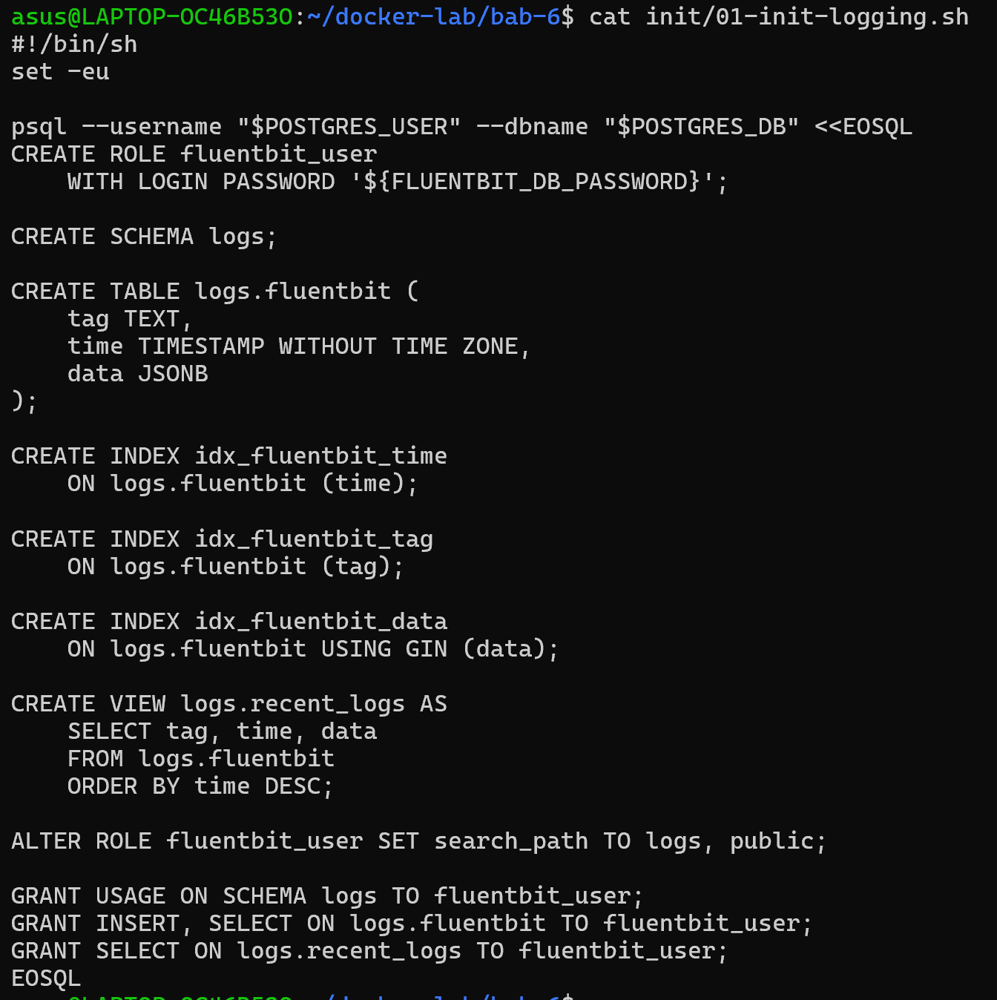
*Gambar 5.6 Tampilan Skrip Inisialisasi Database PostgreSQL pada File `01-init-logging.sh`.*


### 5.7 Konfigurasi Query Analisis (`analysis.sql`)

File `analysis.sql` berisi kumpulan query SQL yang digunakan untuk melakukan analisis terhadap data log yang tersimpan di PostgreSQL. Query ini membantu melihat jumlah event, distribusi log, informasi container, pencarian pesan berdasarkan severity, serta jumlah log dalam interval waktu tertentu.

Berikut isi file `analysis.sql`:

```sql
\pset pager off
\timing on

-- 1. Jumlah event dan rentang waktu.
SELECT
    count(*) AS total_event,
    min(time) AS event_pertama,
    max(time) AS event_terakhir
FROM logs.fluentbit;

-- 2. Distribusi berdasarkan tag Docker.
SELECT
    tag,
    count(*) AS total
FROM logs.fluentbit
GROUP BY tag
ORDER BY total DESC, tag;

-- 3. Metadata terstruktur dari Docker logging driver.
SELECT
    time,
    tag,
    replace(data ->> 'container_name', '/', '') AS container_name,
    data ->> 'source' AS source,
    left(data ->> 'log', 160) AS log_preview
FROM logs.fluentbit
ORDER BY time DESC
LIMIT 15;

-- 4. Pencarian severity pada JSON yang masih berada di field log.
SELECT
    time,
    tag,
    data ->> 'log' AS log_message
FROM logs.fluentbit
WHERE data ->> 'log' ILIKE '%"severity":"ERROR"%'
ORDER BY time DESC;

-- 5. Ringkasan per menit untuk mengamati laju ingest.
SELECT
    date_trunc('minute', time) AS minute_bucket,
    count(*) AS total
FROM logs.fluentbit
GROUP BY minute_bucket
ORDER BY minute_bucket DESC
LIMIT 10;

-- Contoh retensi; tinjau dahulu sebelum menghapus data.
-- DELETE FROM logs.fluentbit
-- WHERE time < CURRENT_TIMESTAMP - INTERVAL '7 days';
```

Penjelasan query:

1. **Jumlah Event dan Rentang Waktu:** Menghitung jumlah seluruh log serta mengetahui waktu log pertama dan terakhir.
2. **Distribusi Log:** Mengelompokkan data log berdasarkan tag Docker untuk mengetahui jumlah log dari setiap container.
3. **Metadata Log:** Menampilkan waktu, tag, nama container, sumber log, dan sebagian isi pesan log.
4. **Pencarian Severity:** Mencari pesan log yang memiliki nilai severity `ERROR`.
5. **Ringkasan per Menit:** Menghitung jumlah log berdasarkan kelompok waktu per menit untuk mengamati laju masuknya log.

Pada bagian akhir terdapat contoh query retensi untuk menghapus log yang berusia lebih dari tujuh hari. Query tersebut masih berupa komentar sehingga tidak dijalankan secara otomatis.

Dengan query tersebut, data log yang tersimpan di PostgreSQL dapat diperiksa dan dianalisis berdasarkan jumlah, sumber, isi pesan, serta waktu penerimaan log.

**Dokumentasi query analisis:**

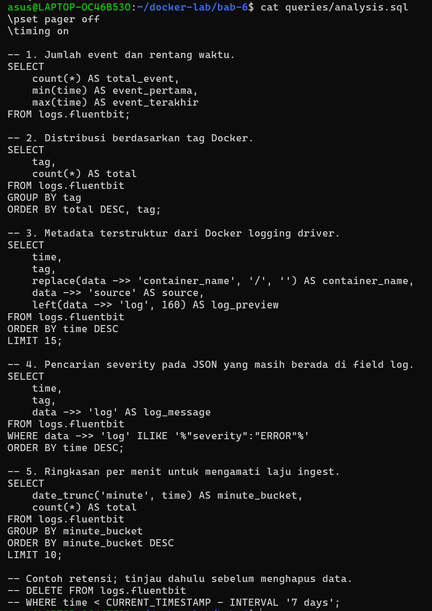
*Gambar 5.7 Tampilan Query Analisis Data Log pada File `analysis.sql`.*


### 5.8 Skrip Pengujian Buffering (`test-buffering.sh`)

File `test-buffering.sh` merupakan skrip otomatisasi yang digunakan untuk menguji proses pengiriman log ketika layanan PostgreSQL dihentikan sementara. Pengujian dilakukan dengan menghentikan PostgreSQL, menjalankan kembali container generator, kemudian mengaktifkan PostgreSQL dan memeriksa apakah terdapat penambahan data log.

Berikut isi skrip `test-buffering.sh`:

```bash
#!/usr/bin/env bash
set -Eeuo pipefail

cd "$(dirname "$0")/.."

if [[ ! -f .env ]]; then
    echo "[FAIL] File .env tidak ditemukan." >&2
    exit 1
fi

set -a
source .env
set +a

count_rows() {
    docker compose exec -T postgres-db \
        psql \
        --username "$POSTGRES_USER" \
        --dbname "$POSTGRES_DB" \
        --tuples-only \
        --no-align \
        --command 'SELECT count(*) FROM logs.fluentbit;'
}

before="$(count_rows)"
echo "[INFO] Jumlah awal: $before"

docker compose stop postgres-db

docker compose up -d --force-recreate \
    generator-auth \
    generator-api \
    generator-worker

echo "[INFO] PostgreSQL berhenti; generator berjalan selama 25 detik."
sleep 25

docker compose start postgres-db

for attempt in {1..30}; do
    if docker compose exec -T postgres-db \
        pg_isready -U "$POSTGRES_USER" -d "$POSTGRES_DB" >/dev/null 2>&1; then
        break
    fi

    if [[ "$attempt" -eq 30 ]]; then
        echo "[FAIL] PostgreSQL tidak kembali sehat." >&2
        exit 1
    fi
    sleep 2
done

for attempt in {1..60}; do
    after="$(count_rows)"
    if (( after > before )); then
        echo "[PASS] Jumlah sesudah pemulihan: $after"
        echo "[INFO] Kenaikan record: $((after - before))"
        exit 0
    fi
    sleep 2
done

echo "[FAIL] Tidak ada record baru setelah PostgreSQL pulih." >&2
echo "[INFO] Periksa: docker compose logs --tail 200 fluent-bit" >&2
exit 1
```

Penjelasan skrip:

1. **Pemeriksaan Environment:** Memastikan file `.env` tersedia sebelum pengujian dijalankan.
2. **Penghitungan Data Awal:** Mengambil jumlah data log yang tersimpan di tabel `logs.fluentbit`.
3. **Penghentian PostgreSQL:** Menghentikan sementara layanan PostgreSQL.
4. **Menjalankan Generator:** Membuat ulang container generator untuk menghasilkan log selama PostgreSQL berhenti.
5. **Pemulihan PostgreSQL:** Mengaktifkan kembali PostgreSQL dan menunggu hingga layanan siap menerima koneksi.
6. **Verifikasi Data:** Membandingkan jumlah log sebelum dan sesudah pengujian untuk mengetahui apakah terdapat penambahan record.

Skrip menampilkan status `[PASS]` apabila jumlah data log setelah pemulihan lebih besar daripada jumlah sebelumnya. Jika tidak ditemukan penambahan data dalam waktu pemeriksaan, skrip akan menampilkan status `[FAIL]`.

Dengan skrip ini, proses pengujian buffering dapat dilakukan secara otomatis dan hasilnya dapat diperiksa berdasarkan jumlah record yang tersimpan di PostgreSQL.


**Dokumentasi skrip pengujian:**

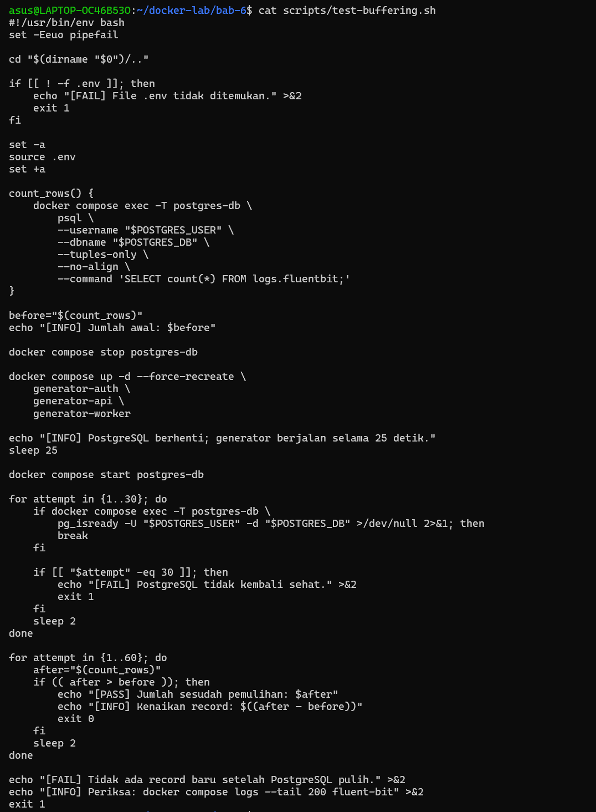
*Gambar 5.9 Tampilan Kode Skrip Pengujian Buffering pada File `test-buffering.sh`.*

**Hasil Pengujian Buffering**

Pengujian buffering dilakukan dengan menjalankan skrip `test-buffering.sh` melalui terminal. Pengujian diawali dengan menghitung jumlah log sebelum PostgreSQL dihentikan sementara. Selanjutnya, container generator dijalankan kembali untuk menghasilkan log selama proses pengujian.

Setelah PostgreSQL diaktifkan kembali, skrip memeriksa jumlah record yang tersimpan di database. Hasil pengujian menunjukkan jumlah log awal sebanyak 13.467 record dan meningkat menjadi 13.527 record setelah pemulihan, sehingga terdapat penambahan sebanyak 60 record.

Berikut dokumentasi hasil pengujian:

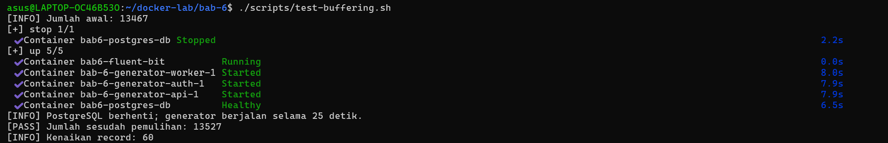
*Gambar 5.10 Hasil Pengujian Buffering dan Penambahan Record Setelah PostgreSQL Dipulihkan.*


# 6. Hasil Implementasi dan Pengujian

Bagian ini membahas hasil implementasi sistem centralized logging menggunakan Fluent Bit dan PostgreSQL. Pengujian dilakukan untuk memastikan setiap layanan berjalan sesuai konfigurasi, log dapat diterima oleh Fluent Bit, serta data log berhasil disimpan dan dianalisis menggunakan PostgreSQL.

## 6.1 Pemeriksaan Status Container Docker

Pemeriksaan status container dilakukan menggunakan perintah `docker compose ps --all`. Pemeriksaan ini bertujuan untuk mengetahui kondisi layanan PostgreSQL, Fluent Bit, dan container generator yang digunakan dalam praktikum.

Hasil pemeriksaan menunjukkan bahwa container PostgreSQL berjalan dengan status `healthy`, sedangkan Fluent Bit berada dalam kondisi `running`. Sementara itu, ketiga container generator menunjukkan status `exited (0)` karena proses pembuatan log telah selesai dijalankan.

Berikut dokumentasi hasil pemeriksaan container:

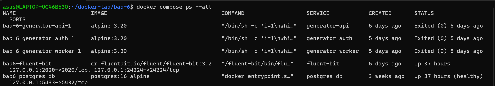
*Gambar 6.1 Hasil Pemeriksaan Status Container Docker pada Praktikum Bab 6.*


## 6.2 Pemeriksaan Health Fluent Bit

Pemeriksaan health Fluent Bit dilakukan melalui HTTP endpoint pada port `2020`. Pemeriksaan ini bertujuan untuk memastikan layanan Fluent Bit berjalan dan dapat memberikan respons terhadap permintaan pemeriksaan kesehatan.

Hasil pemeriksaan menunjukkan bahwa Fluent Bit berhasil memberikan respons melalui endpoint health. Hal ini menunjukkan bahwa layanan Fluent Bit aktif dan endpoint pemantauannya dapat diakses.

Berikut dokumentasi hasil pemeriksaan health Fluent Bit:

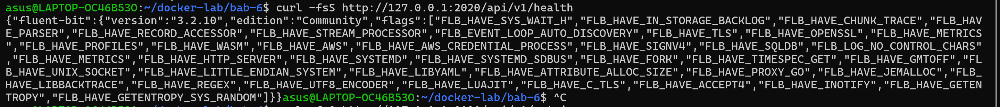
*Gambar 6.2 Hasil Pemeriksaan Health pada Layanan Fluent Bit.*


## 6.3 Pemeriksaan Metrics Fluent Bit

Pemeriksaan metrics dilakukan melalui HTTP endpoint Fluent Bit pada port `2020`. Metrics digunakan untuk melihat informasi statistik mengenai aktivitas pemrosesan log, seperti jumlah record yang diterima, jumlah record yang diproses, serta kondisi pengiriman data ke output.

Berdasarkan hasil pemeriksaan, endpoint metrics Fluent Bit berhasil diakses dan menampilkan informasi statistik layanan. Pada saat pengambilan screenshot, beberapa nilai counter menunjukkan angka nol. Nilai tersebut menggambarkan kondisi counter pada saat pemeriksaan dilakukan.

Berikut dokumentasi hasil pemeriksaan metrics Fluent Bit:

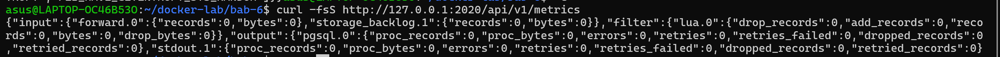
*Gambar 6.3 Hasil Pemeriksaan Metrics pada Layanan Fluent Bit.*


## 6.4 Pemeriksaan Jumlah dan Distribusi Log

Pemeriksaan jumlah dan distribusi log dilakukan menggunakan query SQL pada PostgreSQL. Pemeriksaan ini bertujuan untuk mengetahui jumlah keseluruhan data log yang tersimpan serta distribusi log berdasarkan tag masing-masing container.

Hasil pemeriksaan menunjukkan bahwa tabel `logs.fluentbit` menyimpan sebanyak 13.467 record pada saat pengambilan data. Data tersebut berasal dari beberapa container, termasuk container generator praktikum Bab 6 dan layanan PMB yang menggunakan database yang sama.

Distribusi log berdasarkan tag digunakan untuk mengetahui sumber data log yang tersimpan di dalam tabel.

Berikut dokumentasi hasil pemeriksaan jumlah dan distribusi log:

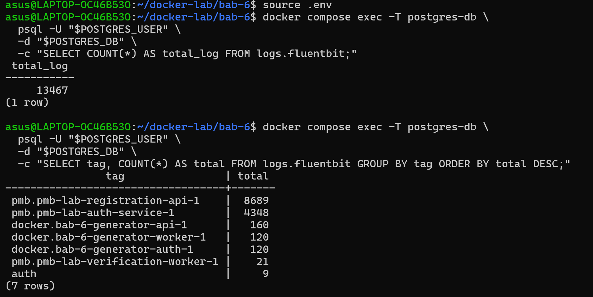
*Gambar 6.4 Hasil Pemeriksaan Jumlah dan Distribusi Data Log pada PostgreSQL.*


## 6.5 Pemeriksaan Detail Log dalam Format JSONB

Pemeriksaan detail log dilakukan untuk melihat struktur data yang tersimpan pada tabel `logs.fluentbit` di PostgreSQL. Data log disimpan menggunakan tipe data JSONB sehingga informasi di dalamnya dapat dikelola dan diakses menggunakan operator JSON PostgreSQL.

Hasil pemeriksaan menunjukkan bahwa data log memiliki beberapa informasi, seperti tag container, waktu pencatatan, sumber log, dan isi pesan log. Pada log dari generator API, nilai token yang diuji telah berubah menjadi `[REDACTED]` setelah melalui proses penyamaran menggunakan filter Lua.

Berikut dokumentasi hasil pemeriksaan detail log:

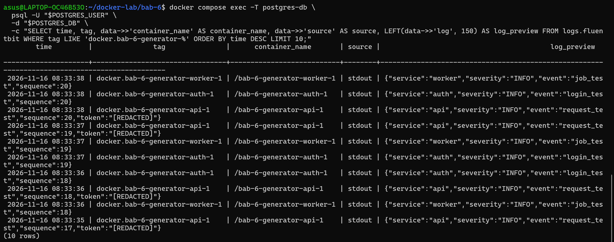
*Gambar 6.5 Tampilan Detail Data Log dalam Format JSONB pada PostgreSQL.*


## 6.6 Verifikasi Tipe Data JSONB

Verifikasi tipe data dilakukan untuk memastikan bahwa kolom `data` pada tabel `logs.fluentbit` menggunakan tipe data JSONB. Pemeriksaan dilakukan menggunakan fungsi `pg_typeof()` pada PostgreSQL dengan memeriksa data log yang berasal dari container generator Bab 6.

Hasil pemeriksaan menunjukkan bahwa sebanyak 400 record dari ketiga container generator menggunakan tipe data `jsonb`. Hal ini membuktikan bahwa data log dari generator berhasil disimpan dalam format JSONB pada PostgreSQL.

Berikut dokumentasi hasil verifikasi tipe data JSONB:

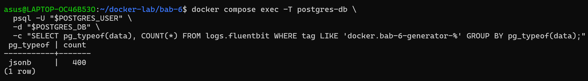
*Gambar 6.6 Hasil Verifikasi Tipe Data JSONB pada Data Log Generator.*


## 6.7 Pemeriksaan View `recent_logs`

Pemeriksaan view dilakukan untuk memastikan bahwa view `logs.recent_logs` berhasil dibuat dan dapat digunakan untuk menampilkan data log berdasarkan waktu terbaru.

View tersebut mengambil informasi dari tabel `logs.fluentbit` dengan menampilkan tiga kolom, yaitu `tag`, `time`, dan `data`. Pengurutan data dilakukan berdasarkan kolom `time` secara menurun sehingga log terbaru ditampilkan terlebih dahulu.

Berikut dokumentasi hasil pemeriksaan view `recent_logs`:

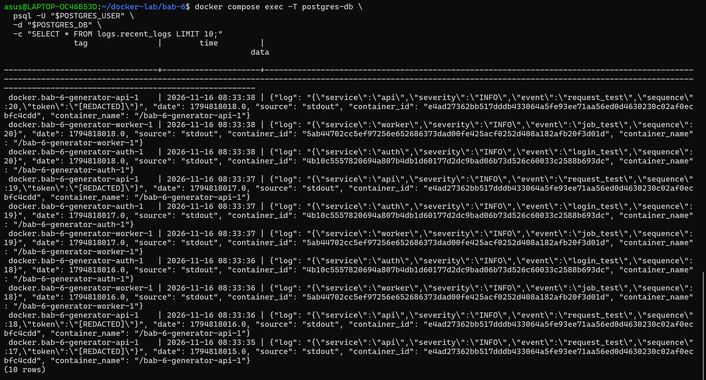
*Gambar 6.7 Hasil Verifikasi View `recent_logs` pada PostgreSQL.*


## 6.8 Pengujian Buffering

Pengujian buffering dilakukan untuk mengamati penambahan data log setelah layanan PostgreSQL dihentikan sementara dan kemudian diaktifkan kembali. Pengujian dijalankan menggunakan skrip `test-buffering.sh`.

Berdasarkan hasil pengujian, jumlah record sebelum pengujian adalah 13.467 dan meningkat menjadi 13.527 setelah PostgreSQL dipulihkan. Dengan demikian, terdapat penambahan sebanyak 60 record.

Hasil tersebut menunjukkan bahwa terdapat penambahan data log setelah layanan PostgreSQL kembali aktif. Namun, hasil pengujian ini belum cukup untuk memastikan bahwa seluruh log berhasil disimpan melalui mekanisme filesystem buffering selama PostgreSQL tidak tersedia.

Berikut dokumentasi hasil pengujian buffering:

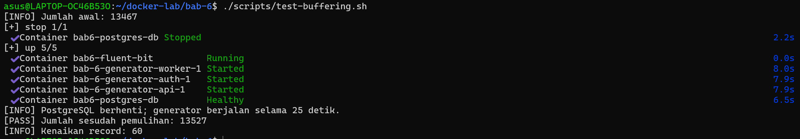
*Gambar 6.8 Hasil Pengujian Buffering pada Sistem Centralized Logging.*
