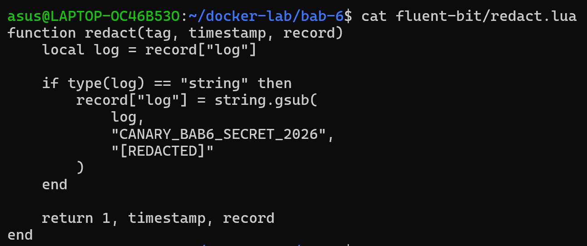

# LAPORAN PRAKTIKUM BAB 6
## CENTRALIZED LOGGING DENGAN FLUENT BIT DAN POSTGRESQL

**Mata Kuliah:** DevOps

**Topik Praktikum:** Centralized Logging dengan Fluent Bit dan PostgreSQL

**Nama:** Fitria Sari Ayuningtyas

**NIM:** 3126640013

**Kelas:** STr LJ Teknik Informatika B


---

# 1. Pendahuluan

Praktikum Bab 6 membahas penerapan centralized logging menggunakan Fluent Bit dan PostgreSQL. Praktikum ini bertujuan untuk memahami proses pengumpulan log dari beberapa container Docker, pemrosesan log menggunakan Fluent Bit, serta penyimpanan data log ke dalam database PostgreSQL dengan format JSONB.

Melalui praktikum ini, dilakukan simulasi pengiriman log dari beberapa container, penerapan filter untuk penyamaran data, serta pengujian penyimpanan dan analisis log menggunakan query SQL.

# 2. Tujuan Praktikum

1. Memahami konsep centralized logging pada lingkungan container.
2. Mengirimkan log container Docker ke Fluent Bit menggunakan logging driver Fluentd.
3. Menyimpan data log ke PostgreSQL menggunakan tipe data JSONB.
4. Melakukan pemrosesan dan penyamaran data log menggunakan filter Lua.
5. Melakukan analisis serta pengujian terhadap data log yang tersimpan.


# 3. Alat dan Lingkungan Praktikum

Praktikum Centralized Logging dilaksanakan menggunakan perangkat keras dan perangkat lunak yang mendukung proses pengumpulan, pemrosesan, penyimpanan, serta analisis log dari container Docker.

Adapun alat dan lingkungan yang digunakan dalam praktikum ini adalah sebagai berikut.

| No. | Alat atau Teknologi | Keterangan |
|---|---|---|
| 1 | Laptop | Perangkat untuk menjalankan praktikum |
| 2 | Windows | Sistem operasi utama |
| 3 | WSL (Windows Subsystem for Linux) | Lingkungan Linux untuk menjalankan perintah praktikum |
| 4 | Docker | Menjalankan aplikasi dalam container |
| 5 | Docker Compose | Mengelola beberapa layanan container |
| 6 | Fluent Bit 3.2 | Mengumpulkan dan memproses log |
| 7 | PostgreSQL 16 | Menyimpan data log |
| 8 | Alpine Linux 3.20 | Image untuk menjalankan container generator log |
| 9 | Git dan GitHub | Mengelola dan menyimpan repository project |
| 10 | Terminal Linux | Menjalankan perintah dan pengujian praktikum |

# 4. Struktur Direktori Project

Project praktikum Bab 6 disusun dalam beberapa direktori untuk memisahkan konfigurasi layanan, skrip inisialisasi database, query analisis, serta file pendukung pengujian. Struktur direktori yang digunakan adalah sebagai berikut.

```text
bab-6/
├── .env.example
├── .gitignore
├── compose.yaml
├── compose.yaml.bak
├── evidence/
│   ├── generator-logs-backup.csv
│   ├── log-export.csv
│   └── log-export.sha256
├── fluent-bit/
│   ├── fluent-bit.conf
│   ├── fluent-bit.conf.bak
│   └── redact.lua
├── init/
│   └── 01-init-logging.sh
├── queries/
│   └── analysis.sql
└── scripts/
    └── test-buffering.sh
```

Keterangan direktori dan file:

- `.env.example`: Berisi contoh variabel lingkungan untuk konfigurasi PostgreSQL dan Fluent Bit.
- `.gitignore`: Menentukan file dan direktori yang tidak disertakan dalam pelacakan Git.
- `compose.yaml`: Mengatur layanan Docker yang digunakan dalam praktikum.
- `compose.yaml.bak`: File cadangan konfigurasi Docker Compose.
- `evidence/`: Menyimpan hasil ekspor log, backup log generator, dan checksum.
- `fluent-bit/`: Menyimpan konfigurasi Fluent Bit, skrip penyamaran data, dan file cadangan konfigurasi.
- `init/`: Menyimpan skrip inisialisasi database PostgreSQL.
- `queries/`: Menyimpan query SQL untuk analisis data log.
- `scripts/`: Menyimpan skrip otomatisasi pengujian buffering.


# 5. Implementasi dan Konfigurasi

Bagian ini menjelaskan implementasi dan konfigurasi komponen yang digunakan dalam pembangunan sistem centralized logging. Konfigurasi meliputi pengaturan variabel lingkungan, pengelolaan file Git, Docker Compose, Fluent Bit, serta inisialisasi database PostgreSQL.

### 5.1 Konfigurasi Environment (`.env.example`)

File `.env.example` digunakan sebagai contoh konfigurasi variabel lingkungan yang dibutuhkan oleh layanan PostgreSQL dan Fluent Bit.

Berikut isi konfigurasi `.env.example`:

```env
POSTGRES_DB=labdb
POSTGRES_USER=labadmin
POSTGRES_PASSWORD=labadminpass123

FLUENTBIT_DB_USER=fluentbit_user
FLUENTBIT_DB_PASSWORD=fluentbitpass123
```

Variabel `POSTGRES_DB`, `POSTGRES_USER`, dan `POSTGRES_PASSWORD` digunakan untuk mengatur database PostgreSQL. Sementara itu, `FLUENTBIT_DB_USER` dan `FLUENTBIT_DB_PASSWORD` digunakan sebagai kredensial koneksi Fluent Bit ke PostgreSQL.

**Dokumentasi konfigurasi:**


*Gambar 5.1 Tampilan Konfigurasi Variabel Environment pada File `.env.example`.*


### 5.2 Konfigurasi Git Ignore (`.gitignore`)

File `.gitignore` digunakan untuk menentukan file dan direktori yang tidak perlu disertakan dalam pelacakan Git. Pada praktikum ini, file tersebut digunakan untuk mengabaikan file environment, file log, serta direktori laporan.

Berikut isi konfigurasi `.gitignore`:

```gitignore
.env
*.log
reports/
```

Keterangan konfigurasi:

1. `.env`: Mengabaikan file yang berisi variabel lingkungan dan kredensial konfigurasi.
2. `*.log`: Mengabaikan seluruh file dengan ekstensi `.log`.
3. `reports/`: Mengabaikan direktori `reports` beserta isinya.

Dengan konfigurasi tersebut, file dan direktori yang telah ditentukan tidak akan disertakan dalam pelacakan Git.


Gambar 5.2 Tampilan Konfigurasi File .gitignore.

### 5.3 Konfigurasi Docker Compose (`compose.yaml`)

File `compose.yaml` digunakan untuk mengatur dan menjalankan seluruh layanan yang dibutuhkan dalam praktikum Centralized Logging. Layanan yang digunakan terdiri dari PostgreSQL sebagai penyimpanan log, Fluent Bit sebagai pengumpul dan pengirim log, serta tiga container generator untuk menghasilkan log secara otomatis.

**a. Konfigurasi layanan PostgreSQL**

```yaml
services:
  postgres-db:
    image: postgres:16-alpine
    container_name: bab6-postgres-db
    restart: unless-stopped
    env_file:
      - .env
    ports:
      - "127.0.0.1:5433:5432"
    volumes:
      - postgres_data:/var/lib/postgresql/data
      - ./init:/docker-entrypoint-initdb.d:ro
    healthcheck:
      test: ["CMD-SHELL", "pg_isready -U \"$${POSTGRES_USER}\" -d \"$${POSTGRES_DB}\""]
      interval: 5s
      timeout: 3s
      retries: 10
```

PostgreSQL menggunakan image `postgres:16-alpine` dan berfungsi sebagai tempat penyimpanan log. Data disimpan menggunakan Docker volume agar tetap tersedia meskipun container dihentikan atau dibuat ulang. Health check digunakan untuk memastikan PostgreSQL siap menerima koneksi.

**b. Konfigurasi layanan Fluent Bit**

```yaml
  fluent-bit:
    image: cr.fluentbit.io/fluent/fluent-bit:3.2
    container_name: bab6-fluent-bit
    restart: unless-stopped
    env_file:
      - .env
    depends_on:
      postgres-db:
        condition: service_healthy
    ports:
      - "127.0.0.1:2020:2020"
      - "127.0.0.1:24224:24224"
    volumes:
      - ./fluent-bit/fluent-bit.conf:/fluent-bit/etc/fluent-bit.conf:ro
      - fluentbit_storage:/var/log/flb-storage
      - ./fluent-bit/redact.lua:/fluent-bit/etc/redact.lua:ro
    command: ["--config", "/fluent-bit/etc/fluent-bit.conf"]
```

Fluent Bit bertugas menerima log dari container lain, melakukan pemrosesan sesuai konfigurasi, kemudian mengirimkannya ke PostgreSQL. Layanan ini dijalankan setelah PostgreSQL dinyatakan sehat. Volume `fluentbit_storage` digunakan untuk mendukung penyimpanan buffer berbasis filesystem.

**c. Konfigurasi container generator**

```yaml
  generator-auth:
    image: alpine:3.20
    command:
      - /bin/sh
      - -c
      - |
        i=1
        while [ "$$i" -le 20 ]; do
          printf '{"service":"auth","severity":"INFO","event":"login_test","sequence":%s}\n' "$$i"
          i=$$((i + 1))
          sleep 1
        done
    logging:
      driver: fluentd
      options:
        fluentd-address: "127.0.0.1:24224"
        fluentd-async: "true"
        tag: "docker.{{.Name}}"
    depends_on:
      - fluent-bit

  generator-api:
    image: alpine:3.20
    command:
      - /bin/sh
      - -c
      - |
        i=1
        while [ "$$i" -le 20 ]; do
          printf '{"service":"api","severity":"INFO","event":"request_test","sequence":%s,"token":"CANARY_BAB6_SECRET_2026"}\n' "$$i"
          i=$$((i + 1))
          sleep 1
        done
    logging:
      driver: fluentd
      options:
        fluentd-address: "127.0.0.1:24224"
        fluentd-async: "true"
        tag: "docker.{{.Name}}"
    depends_on:
      - fluent-bit

  generator-worker:
    image: alpine:3.20
    command:
      - /bin/sh
      - -c
      - |
        i=1
        while [ "$$i" -le 20 ]; do
          printf '{"service":"worker","severity":"INFO","event":"job_test","sequence":%s}\n' "$$i"
          i=$((i + 1))
          sleep 1
        done
    logging:
      driver: fluentd
      options:
        fluentd-address: "127.0.0.1:24224"
        fluentd-async: "true"
        tag: "docker.{{.Name}}"
    depends_on:
      - fluent-bit

volumes:
  postgres_data:
  fluentbit_storage:
```

Ketiga container generator menggunakan image Alpine dan menghasilkan log dalam format JSON. Log dikirim menggunakan Docker logging driver `fluentd` menuju Fluent Bit melalui port `24224`. Setiap generator menghasilkan 20 event dengan interval satu detik. Pada konfigurasi ini, generator menghasilkan event dengan severity `INFO`.

Secara keseluruhan, Docker Compose menghubungkan container generator, Fluent Bit, dan PostgreSQL sehingga proses pengumpulan, pemrosesan, serta penyimpanan log dapat dilakukan secara terpusat.


### 5.4 Konfigurasi Fluent Bit (`fluent-bit.conf`)

File `fluent-bit.conf` digunakan untuk mengatur proses pengumpulan, pemrosesan, dan pengiriman log dari container Docker ke PostgreSQL. Konfigurasi ini terdiri dari bagian service, input, filter, dan output.

Berikut isi konfigurasi `fluent-bit.conf`:

```ini
[SERVICE]
    Flush           1
    Log_Level       info
    HTTP_Server     On
    HTTP_Listen     0.0.0.0
    HTTP_Port       2020
    storage.path    /var/log/flb-storage

[INPUT]
    Name            forward
    Listen          0.0.0.0
    Port            24224
    storage.type    filesystem

[FILTER]
    Name            lua
    Match           docker.bab-6-generator-api-1
    Script          /fluent-bit/etc/redact.lua
    Call            redact

[OUTPUT]
    Name            pgsql
    Match           *
    Host            postgres-db
    Port            5432
    Database        ${POSTGRES_DB}
    User            ${FLUENTBIT_DB_USER}
    Password        ${FLUENTBIT_DB_PASSWORD}
    Table           fluentbit
    Retry_Limit     False

[OUTPUT]
    Name            stdout
    Match           *
```

Penjelasan konfigurasi:

1. **Service:** Mengatur interval pengiriman log setiap satu detik, tingkat pencatatan informasi, HTTP server untuk pemantauan, serta lokasi penyimpanan buffer berbasis filesystem.
2. **Input:** Menggunakan plugin `forward` untuk menerima log dari container Docker melalui port `24224`.
3. **Filter:** Menggunakan plugin Lua untuk menjalankan proses penyamaran data pada log dari container generator API.
4. **Output PostgreSQL:** Mengirim seluruh log yang diterima ke database PostgreSQL pada tabel `fluentbit`.
5. **Output stdout:** Menampilkan log pada standard output Fluent Bit untuk membantu pemantauan proses pengiriman log.

Dengan konfigurasi tersebut, Fluent Bit dapat menerima log dari beberapa container, melakukan pemrosesan menggunakan filter Lua pada sumber log yang ditentukan, serta mengirimkan data log ke PostgreSQL.


### 5.5 Konfigurasi Lua untuk Penyamaran Data (`redact.lua`)

File `redact.lua` digunakan sebagai skrip pemrosesan log dengan bahasa pemrograman Lua. Skrip ini berfungsi untuk menyamarkan nilai token tertentu pada log yang diterima dari container generator API.

Berikut isi konfigurasi `redact.lua`:

```lua
function redact(tag, timestamp, record)
    local log = record["log"]

    if type(log) == "string" then
        record["log"] = string.gsub(
            log,
            "CANARY_BAB6_SECRET_2026",
            "[REDACTED]"
        )
    end

    return 1, timestamp, record
end
```

Penjelasan skrip:

1. `function redact(tag, timestamp, record)`: Mendefinisikan fungsi Lua yang menerima tag, waktu, dan data log.
2. `local log = record["log"]`: Mengambil isi pesan log dari field `log`.
3. `type(log) == "string"`: Memastikan nilai log berupa teks sebelum dilakukan pemrosesan.
4. `string.gsub()`: Mengganti teks `CANARY_BAB6_SECRET_2026` dengan `[REDACTED]`.
5. `return 1, timestamp, record`: Mengembalikan record yang telah diproses agar dapat diteruskan oleh Fluent Bit.

Melalui skrip tersebut, nilai token yang telah ditentukan tidak ditampilkan dalam bentuk aslinya pada pesan log yang diproses. Proses penyamaran ini membantu mengurangi risiko tereksposnya informasi sensitif dalam penyimpanan log.

**Dokumentasi konfigurasi:**


*Gambar 5.5 Tampilan Konfigurasi Skrip Penyamaran Data pada File `redact.lua`.*

