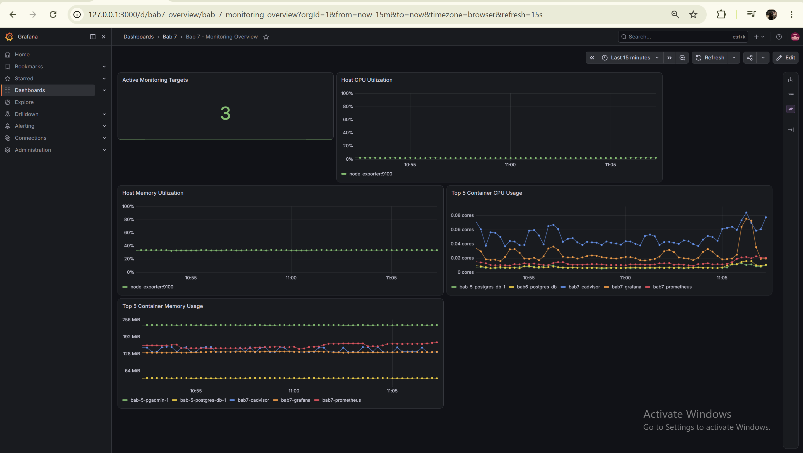
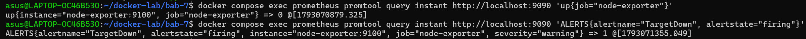
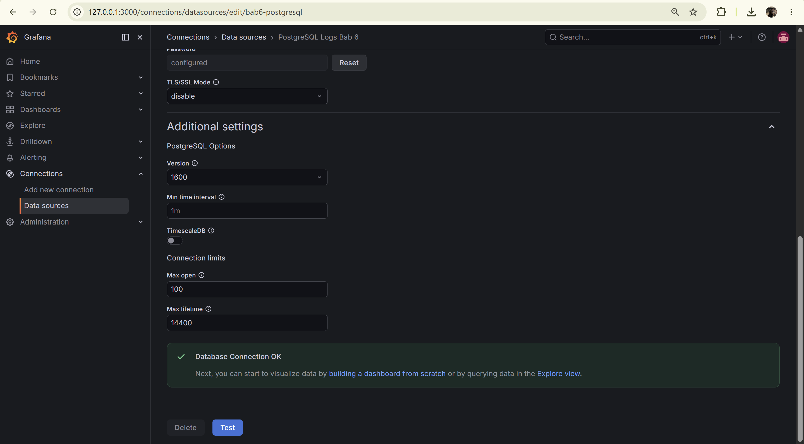
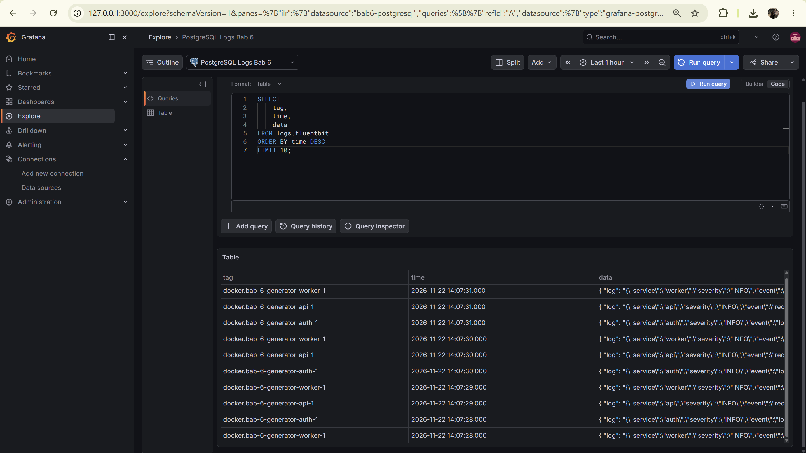

# BAB 7 — MONITORING RESOURCE DENGAN PROMETHEUS, CADVISOR, NODE EXPORTER, DAN GRAFANA

**Disusun untuk Memenuhi Tugas Praktikum Mata Kuliah DevOps**

- **Nama:** Fitria Sari Ayuningtyas

- **NIM:** 3126640013

- **Kelas:** STr LJ Teknik Informatika B

- **Judul Praktikum:** Monitoring Resource dengan Prometheus, cAdvisor, Node Exporter, dan Grafana
  
## 1. Tujuan Praktikum

Praktikum ini bertujuan untuk:
1. Membedakan monitoring metrics dan logging events.
2. Menjalankan Prometheus sebagai scraper dan time-series database.
3. Mengumpulkan metrik resource host menggunakan Node Exporter dan metrik container menggunakan cAdvisor.
4. Membuat dashboard Grafana untuk memantau penggunaan CPU, memori, disk, jaringan, dan container.
5. Mengintegrasikan data log PostgreSQL dari praktikum Bab 6 ke Grafana.

## 2. Dasar Teori Singkat

Monitoring merupakan proses pengamatan kondisi sistem melalui pengumpulan metrik secara berkala, seperti penggunaan CPU, memori, disk, dan jaringan. Monitoring membantu mengetahui kondisi dan perubahan performa sistem, sedangkan logging digunakan untuk mencatat kejadian atau aktivitas secara lebih terperinci.

Prometheus merupakan sistem monitoring yang menggunakan metode *pull*, yaitu mengambil metrik dari endpoint target secara berkala dan menyimpannya dalam bentuk time-series database. Node Exporter digunakan untuk mengumpulkan metrik resource host, sedangkan cAdvisor digunakan untuk mengumpulkan metrik penggunaan resource container Docker.

Grafana merupakan platform visualisasi yang digunakan untuk menampilkan data dari berbagai sumber, termasuk Prometheus dan PostgreSQL, dalam bentuk dashboard. Melalui PromQL, pengguna dapat melakukan query dan analisis terhadap metrik yang dikumpulkan Prometheus. Integrasi monitoring dan logging memungkinkan kondisi sistem diamati sekaligus membantu proses analisis ketika terjadi gangguan.

## 3. Alat dan Lingkungan

| **Komponen** | **Hasil Identifikasi** |
|---|---|
| Operating System | Ubuntu pada WSL 2 |
| Pengguna eksekusi | `asus` |
| Direktori kerja | `~/docker-lab/bab-7` |
| Docker Engine | 29.7.2 |
| Docker Compose | 5.5.0 |
| Prometheus | v3.14.0 |
| Grafana | 13.1.4 |
| Node Exporter | v1.12.1 |
| cAdvisor | v0.60.5 |
| PostgreSQL | Database log Bab 6 |
| Web Browser | Digunakan untuk mengakses Prometheus dan Grafana |

## 4. Langkah Praktikum

### 4.1 Persiapan dan Konfigurasi Monitoring

Praktikum diawali dengan menyiapkan direktori kerja Bab 7 serta file konfigurasi yang dibutuhkan. Docker Compose digunakan untuk menjalankan Prometheus, Grafana, Node Exporter, dan cAdvisor dalam satu jaringan monitoring. Selanjutnya, dilakukan konfigurasi Prometheus untuk menentukan target pengambilan metrik serta recording rules dan alert rules.

**Gambar 1. Konfigurasi Monitoring**

### 4.2 Menjalankan dan Memverifikasi Monitoring Stack

Seluruh layanan dijalankan menggunakan Docker Compose. Verifikasi dilakukan melalui script `verify-stack.sh` untuk memastikan layanan Prometheus dan Grafana siap digunakan, target monitoring aktif, serta query PromQL dapat menghasilkan data metrik.

**Gambar 2. Hasil Verifikasi Monitoring Stack**

### 4.3 Membuat Dashboard Monitoring

Grafana digunakan untuk menampilkan data metrik dari Prometheus dalam bentuk dashboard. Dashboard mencakup jumlah target aktif, penggunaan CPU dan memori host, serta penggunaan CPU dan memori container.

**Gambar 3. Dashboard Monitoring Grafana**

### 4.4 Melakukan Pengujian Alert

Pengujian dilakukan menggunakan load generator untuk menghasilkan beban CPU pada container sehingga alert `ContainerHighCPU` dapat diuji. Selanjutnya, layanan Node Exporter dihentikan sementara untuk menguji kemampuan Prometheus dalam mendeteksi target yang tidak tersedia melalui alert `TargetDown`.

**Gambar 4. Pengujian Alert CPU**

**Gambar 5. Pengujian Alert TargetDown**

### 4.5 Mengintegrasikan PostgreSQL Bab 6

PostgreSQL dari praktikum Bab 6 ditambahkan sebagai data source pada Grafana. Pengujian dilakukan melalui fitur Explore dengan menjalankan query SQL untuk membaca struktur tabel dan menampilkan data log dari tabel `logs.fluentbit`.

**Gambar 6. Pengujian Koneksi PostgreSQL**

**Gambar 7. Hasil Query Data Log PostgreSQL**

## 5. Hasil Pengujian

Berdasarkan praktikum yang telah dilakukan, diperoleh hasil pengujian sebagai berikut.

### 5.1 Verifikasi Monitoring Stack

Hasil verifikasi menunjukkan bahwa Prometheus dan Grafana berhasil berjalan. Ketiga target monitoring, yaitu Prometheus, Node Exporter, dan cAdvisor, berstatus UP dengan total tiga target aktif dan tidak terdapat target DOWN. Query PromQL untuk metrik CPU dan memori juga berhasil menghasilkan data.

**Gambar 8. Hasil Verifikasi Monitoring Stack**

### 5.2 Hasil Dashboard Monitoring

Dashboard Grafana berhasil menampilkan informasi penggunaan resource, meliputi jumlah target aktif, penggunaan CPU dan memori host, serta penggunaan CPU dan memori container. Hasil visualisasi menunjukkan bahwa data metrik berhasil diterima dan ditampilkan melalui Grafana.

**Gambar 9. Dashboard Monitoring**

### 5.3 Hasil Pengujian Alert

Pengujian `ContainerHighCPU` menghasilkan penggunaan CPU pada container `bab7-load-generator` sebesar 0,500188 cores. Alert terdeteksi dengan status `firing`, sehingga menunjukkan bahwa Prometheus berhasil mendeteksi penggunaan CPU yang memenuhi kondisi aturan.

Pengujian `TargetDown` dilakukan dengan menghentikan Node Exporter. Hasil query menunjukkan nilai `up` sebesar 0 dan alert `TargetDown` berstatus `firing`. Setelah layanan dipulihkan, metrik CPU kembali tersedia dengan nilai sekitar 0,5395 atau 53,95%.

**Gambar 10. Hasil Pengujian Alert CPU**

**Gambar 11. Hasil Pengujian Alert TargetDown**

**Gambar 12. Verifikasi Metrik CPU Setelah Pemulihan**

### 5.4 Hasil Integrasi PostgreSQL dengan Grafana

Integrasi PostgreSQL Bab 6 dengan Grafana berhasil dilakukan. Pengujian koneksi menghasilkan pesan `Database Connection OK`. Selanjutnya, query SQL berhasil menampilkan 10 data log dari tabel `logs.fluentbit`, yang terdiri atas informasi tag, waktu pencatatan, dan data log dalam format JSON.

**Gambar 13. Hasil Koneksi PostgreSQL**

**Gambar 14. Hasil Query Data Log PostgreSQL**

