# BAB 7 — MONITORING RESOURCE DENGAN PROMETHEUS, CADVISOR, NODE EXPORTER, DAN GRAFANA

**Disusun untuk Memenuhi Tugas Praktikum Mata Kuliah DevOps**

- **Nama:** Fitria Sari Ayuningtyas

- **NIM:** 3126640013

- **Kelas:** STr LJ Teknik Informatika B

- **Judul Praktikum:** Monitoring Resource dengan Prometheus, cAdvisor, Node Exporter, dan Grafana
  
## 1. Tujuan Praktikum

Praktikum ini bertujuan untuk:
1. Membedakan monitoring metrics dan logging events.
2. Menjalankan Prometheus sebagai scraper dan time-series database.
3. Mengumpulkan metrik resource host menggunakan Node Exporter dan metrik container menggunakan cAdvisor.
4. Membuat dashboard Grafana untuk memantau penggunaan CPU, memori, disk, jaringan, dan container.
5. Mengintegrasikan data log PostgreSQL dari praktikum Bab 6 ke Grafana.

## 2. Dasar Teori Singkat

Monitoring merupakan proses pengamatan kondisi sistem melalui pengumpulan metrik secara berkala, seperti penggunaan CPU, memori, disk, dan jaringan. Monitoring membantu mengetahui kondisi dan perubahan performa sistem, sedangkan logging digunakan untuk mencatat kejadian atau aktivitas secara lebih terperinci.

Prometheus merupakan sistem monitoring yang menggunakan metode *pull*, yaitu mengambil metrik dari endpoint target secara berkala dan menyimpannya dalam bentuk time-series database. Node Exporter digunakan untuk mengumpulkan metrik resource host, sedangkan cAdvisor digunakan untuk mengumpulkan metrik penggunaan resource container Docker.

Grafana merupakan platform visualisasi yang digunakan untuk menampilkan data dari berbagai sumber, termasuk Prometheus dan PostgreSQL, dalam bentuk dashboard. Melalui PromQL, pengguna dapat melakukan query dan analisis terhadap metrik yang dikumpulkan Prometheus. Integrasi monitoring dan logging memungkinkan kondisi sistem diamati sekaligus membantu proses analisis ketika terjadi gangguan.

## 3. Alat dan Lingkungan

| **Komponen** | **Hasil Identifikasi** |
|---|---|
| Operating System | Ubuntu pada WSL 2 |
| Pengguna eksekusi | `asus` |
| Direktori kerja | `~/docker-lab/bab-7` |
| Docker Engine | 29.7.2 |
| Docker Compose | 5.5.0 |
| Prometheus | v3.14.0 |
| Grafana | 13.1.4 |
| Node Exporter | v1.12.1 |
| cAdvisor | v0.60.5 |
| PostgreSQL | Database log Bab 6 |
| Web Browser | Digunakan untuk mengakses Prometheus dan Grafana |

## 4. Langkah Praktikum

### 4.1 Persiapan dan Konfigurasi Monitoring

Praktikum diawali dengan menyiapkan direktori kerja dan file konfigurasi yang diperlukan. Selanjutnya dilakukan konfigurasi Docker Compose untuk menjalankan Prometheus, Grafana, Node Exporter, dan cAdvisor. Prometheus dikonfigurasi untuk mengambil metrik dari masing-masing layanan melalui mekanisme scraping.

Selain itu, dibuat konfigurasi recording rules dan alert rules untuk membantu proses pengolahan metrik serta mendeteksi kondisi resource yang melebihi batas tertentu.

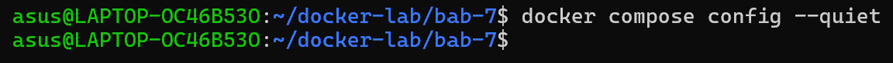

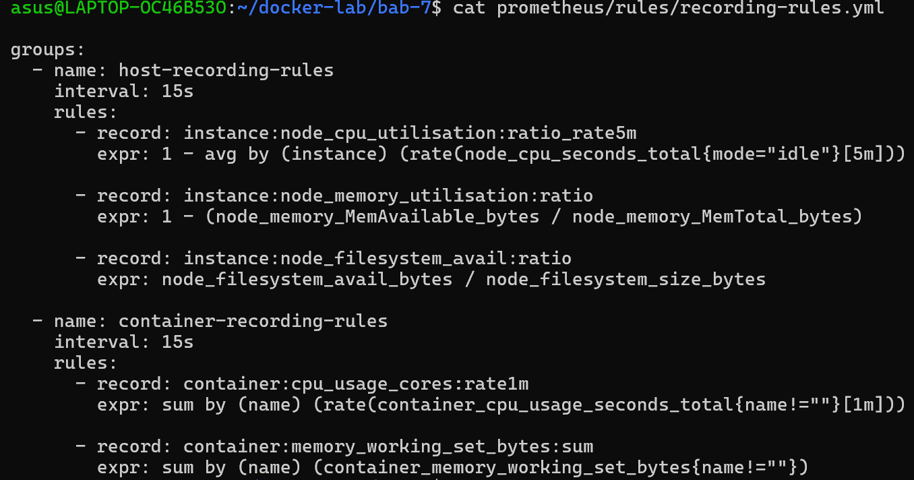

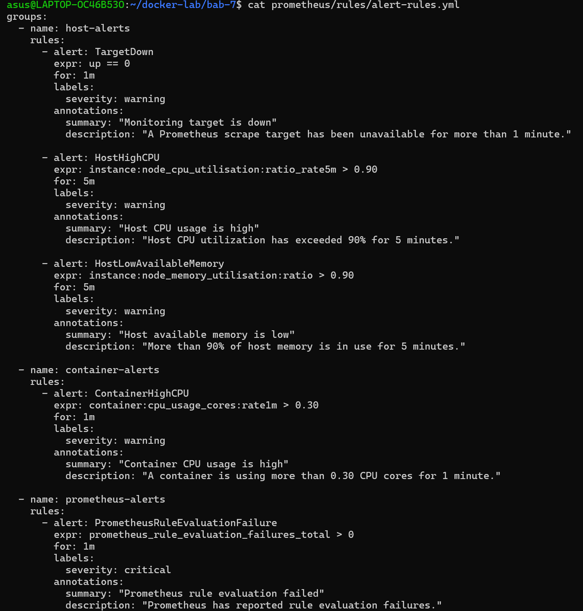

### 4.2 Validasi Konfigurasi

Setelah konfigurasi selesai, dilakukan validasi terhadap file Prometheus, dashboard Grafana, dan script pengujian. Validasi ini bertujuan memastikan konfigurasi dapat digunakan sebelum seluruh layanan dijalankan.

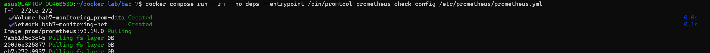

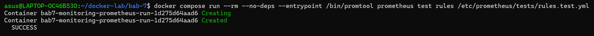

### 4.3 Konfigurasi Grafana

Grafana dikonfigurasi menggunakan Prometheus sebagai sumber data utama. Selanjutnya dilakukan pengaturan dashboard provider dan dashboard monitoring untuk menampilkan informasi penggunaan CPU, memori, serta resource container.

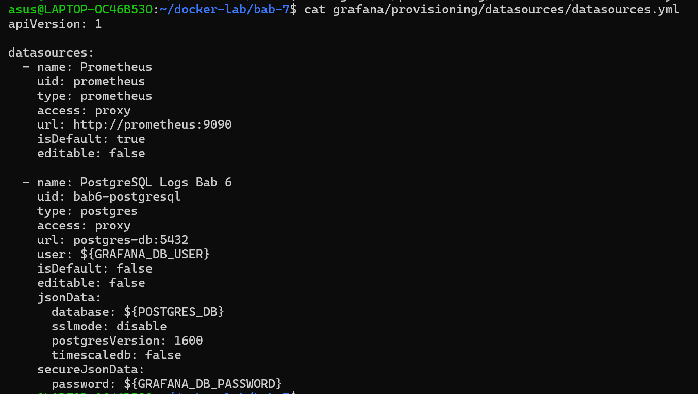

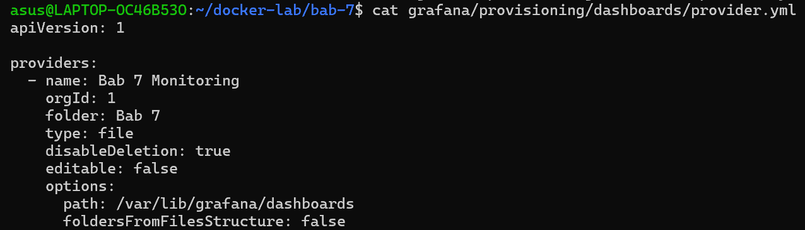

### 4.4 Menjalankan Layanan Monitoring

Seluruh layanan dijalankan menggunakan Docker Compose. Setelah proses menjalankan layanan, dilakukan pemeriksaan status container untuk memastikan komponen monitoring telah berjalan.

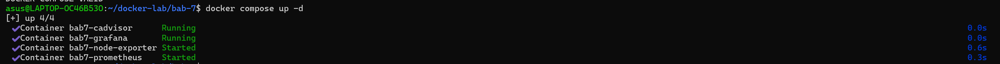

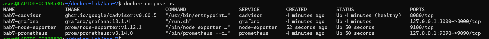

### 4.5 Integrasi PostgreSQL Bab 6

Tahap terakhir adalah mengintegrasikan PostgreSQL dari praktikum Bab 6 sebagai sumber data tambahan pada Grafana. Integrasi dilakukan agar data log yang tersimpan di PostgreSQL dapat diakses dan ditampilkan melalui fitur Explore menggunakan query SQL.

## 5. Hasil Pengujian

### 5.1 Verifikasi Monitoring Stack

Berdasarkan hasil verifikasi, seluruh layanan monitoring berhasil dijalankan. Prometheus, Node Exporter, dan cAdvisor menunjukkan status `UP` dengan jumlah tiga target aktif dan tidak terdapat target yang berstatus `DOWN`. Pengujian menggunakan PromQL juga berhasil menampilkan data metrik CPU, memori, dan container.

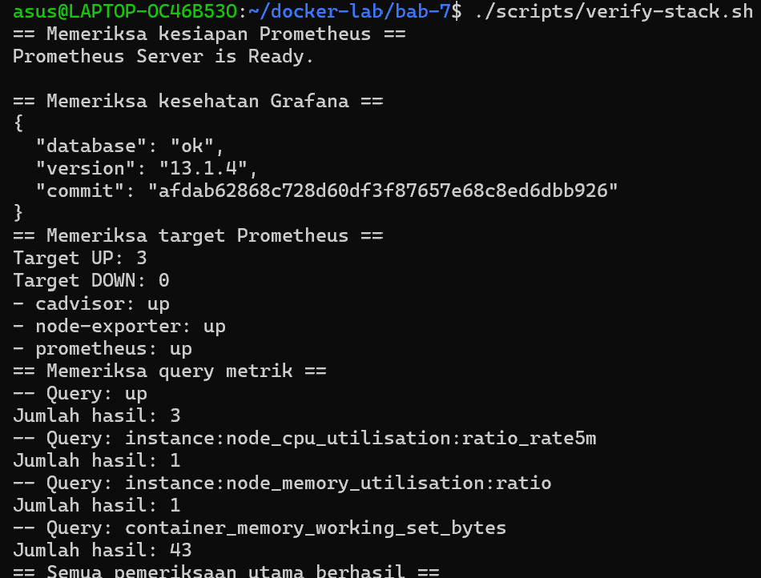

### 5.2 Dashboard Monitoring Grafana

Dashboard Grafana berhasil menampilkan informasi monitoring berupa jumlah target aktif, penggunaan CPU host, penggunaan memori host, serta penggunaan CPU dan memori pada container. Data tersebut diperoleh dari Prometheus dan ditampilkan dalam bentuk visualisasi.

### 5.3 Pengujian Alert

Pengujian alert dilakukan menggunakan load generator untuk menghasilkan peningkatan penggunaan CPU. Hasil pengujian menunjukkan bahwa metrik penggunaan CPU container berhasil terbaca dan alert `ContainerHighCPU` berada dalam status `firing`.

Selanjutnya, Node Exporter dihentikan sementara untuk menguji alert `TargetDown`. Hasilnya, nilai `up` pada job Node Exporter menjadi `0` dan alert `TargetDown` berhasil terpicu.

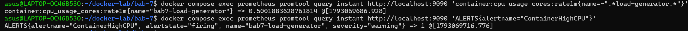

Setelah Node Exporter dijalankan kembali, metrik CPU host kembali tersedia melalui recording rule. Hal ini menunjukkan bahwa pengumpulan metrik dapat berjalan kembali setelah layanan dipulihkan.

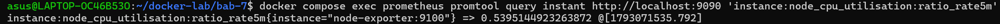

### 5.4 Integrasi PostgreSQL Bab 6

Integrasi PostgreSQL sebagai sumber data Grafana berhasil dilakukan. Pengujian koneksi menunjukkan hasil `Database Connection OK`. Selanjutnya, query SQL terhadap tabel `logs.fluentbit` berhasil menampilkan 10 data log terbaru yang tersimpan pada PostgreSQL.

Dengan demikian, Grafana berhasil mengakses data monitoring dari Prometheus sekaligus data log dari PostgreSQL Bab 6.

## 6. Analisis

Berdasarkan hasil praktikum, Prometheus berhasil mengumpulkan metrik dari Node Exporter dan cAdvisor, sedangkan Grafana berhasil menampilkan data tersebut dalam bentuk dashboard. Pengujian juga menunjukkan bahwa sistem dapat mendeteksi kondisi tertentu melalui alert `ContainerHighCPU` dan `TargetDown`. Hal ini membuktikan bahwa monitoring dapat membantu mengetahui kondisi resource host maupun container secara berkala.

Salah satu kendala yang ditemukan terjadi saat melakukan query data log PostgreSQL. Query awal mengalami kesalahan karena menggunakan nama kolom `timestamp`, sedangkan kolom waktu pada tabel `logs.fluentbit` sebenarnya bernama `time`. Setelah nama kolom disesuaikan, query berhasil dijalankan dan menampilkan data log. Kendala tersebut menunjukkan pentingnya memeriksa struktur tabel sebelum menyusun query SQL.

Dari sisi operasional dan keamanan, penggunaan cAdvisor dengan konfigurasi `privileged: true` memiliki risiko karena memberikan hak akses container yang tinggi terhadap host. Selain itu, endpoint metrik dapat memperlihatkan informasi mengenai kondisi dan konfigurasi infrastruktur. Oleh karena itu, konfigurasi tersebut perlu dibatasi penggunaannya pada lingkungan praktikum.

Untuk penerapan pada lingkungan produksi, hak akses container sebaiknya dibatasi sesuai kebutuhan, endpoint monitoring hanya dapat diakses melalui jaringan internal, serta kredensial disimpan dengan aman. Selain itu, aturan alert perlu disesuaikan dengan kondisi sistem sebenarnya agar notifikasi yang dihasilkan relevan dan dapat ditindaklanjuti.

## 7. Threat Statement

Sistem monitoring memiliki beberapa potensi ancaman, seperti akses tidak sah terhadap endpoint metrik, penyalahgunaan hak akses container, serta kebocoran kredensial Grafana dan PostgreSQL. Informasi metrik yang terbuka juga dapat memberikan gambaran mengenai kondisi dan konfigurasi infrastruktur.

Apabila ancaman tersebut tidak dikendalikan, pihak yang tidak berwenang dapat memperoleh informasi internal sistem atau menyalahgunakan akses yang tersedia. Oleh karena itu, diperlukan pembatasan akses endpoint monitoring, pengelolaan kredensial secara aman, serta pembatasan hak akses container sesuai kebutuhan.

## 8. Tindak Lanjut

Berdasarkan hasil praktikum, beberapa tindak lanjut yang dapat dilakukan untuk meningkatkan kualitas sistem monitoring adalah:

1. Menyesuaikan threshold alert berdasarkan penggunaan resource yang sebenarnya agar notifikasi lebih relevan.
2. Membatasi akses terhadap endpoint Prometheus, Node Exporter, dan cAdvisor agar informasi metrik tidak dapat diakses sembarang pihak.
3. Mengamankan kredensial Grafana dan PostgreSQL serta menghindari penyimpanan informasi sensitif di repository.
4. Melakukan pemantauan kapasitas penyimpanan Prometheus agar data metrik tidak memenuhi ruang disk.
5. Mengembangkan dashboard dengan menambahkan visualisasi penggunaan disk dan jaringan agar pemantauan resource lebih lengkap.

## 9. Kesimpulan

Berdasarkan praktikum Bab 7, sistem monitoring resource menggunakan Prometheus, Node Exporter, cAdvisor, dan Grafana berhasil dijalankan. Prometheus dapat mengumpulkan metrik penggunaan resource host dan container, sedangkan Grafana dapat menampilkan data tersebut melalui dashboard monitoring.

Pengujian alert `ContainerHighCPU` dan `TargetDown` juga berhasil menunjukkan kemampuan sistem dalam mendeteksi perubahan kondisi layanan. Selain itu, integrasi PostgreSQL Bab 6 berhasil dilakukan sehingga data log dapat diakses melalui Grafana.

Dengan demikian, praktikum ini memberikan pemahaman mengenai penerapan monitoring resource dan integrasi data monitoring dengan logging untuk membantu pengamatan kondisi sistem.

## 10. Penggunaan AI

Dalam penyusunan laporan praktikum ini, AI digunakan sebagai alat bantu untuk memahami materi, membantu menyusun penjelasan hasil praktikum, serta merapikan dokumentasi. Seluruh proses praktikum dan pengujian dilakukan secara langsung oleh praktikan.

## 11. Referensi

1. Prometheus Documentation. https://prometheus.io/docs/
2. Grafana Documentation. https://grafana.com/docs/
3. Prometheus Node Exporter. https://github.com/prometheus/node_exporter
4. cAdvisor Documentation. https://github.com/google/cadvisor
